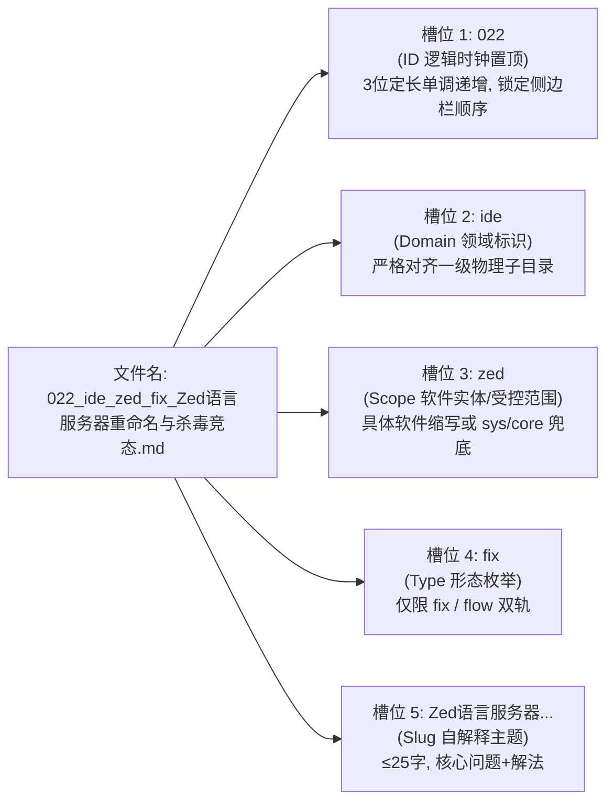
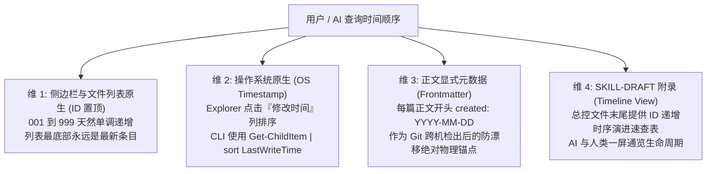

# 50-Windows平铺知识库文件名元数据嵌入架构与双端自解释命名规范

> **条目定位**：Type B 方案与流水线型条目  
> **适用场景**：单目录平铺（零子目录）知识库在文章规模达到 50~100+ 篇时，解决 Windows 资源管理器与编辑器侧边栏排序割裂、长标题截断、机器无法正则提取分类标签等元数据缺失问题，同时使 ID 顺序与软件实体聚类、领域分块及认知流深度契合。

---

## 一、业务场景与元数据痛点

在坚持**“单目录完全平铺（Flat Structure，无子目录嵌套）”**的知识库架构下，随着条目从数十篇生长至 70+ 篇乃至数百篇，原有的单一流水号命名或领域前置命名法在不同视角下存在张力：

1. **编辑器侧边栏认知割裂（若领域前置）**：
   - 若将领域或软件名放最前，侧边栏文件列表将按字母排序，导致 `001~073` 序号乱序跳跃，严重破坏按顺号定位、按时间由旧到新查阅的人类本能。
   - **核心诉求**：必须将 `<id>` 逻辑时钟置顶于首位，使编辑器侧边栏与资源管理器**天然呈现单调递增的编号顺序**，最新条目永远规整沉淀在底部。
2. **同款软件/技术实体需要标识明确**：
   - 宏观领域（`ide`、`win`）颗粒度太粗，需要独立槽位 `<scope>` 明确指出具体软件（如 `zed`、`cursor`、`terminal`）或受控兜底（`sys`、`core`、`fs`、`cli`），消除在冗长汉字中寻找实体的疲劳。
3. **条目属性隐匿（形态缺失与契约漂移）**：
   - 必须直接通过文件名判断条目属于 **Type A（疑难报错排障 `fix`）** 还是 **Type B（端到端实现流水线 `flow`）**，彻底收敛为极简双轨制。
4. **单目录容量逼近物理分层阈值**：
   - 知识库条目突破 70+ 篇，未来扩展到 150+ 篇时将面临物理分层诉求。必须在平铺设计之初将文件名设计为“序列化的虚拟路径”，确保未来分层迁移时 0 代码断裂、0 引用重构成本。
5. **机器消费高昂与视窗截断**：
   - 外部 Agent 或脚本无法零 I/O 成本提取元数据，必须全量读取正文 frontmatter；传统长标题动辄 40~50 字符，在分屏或详细信息模式下关键动作往往被尾部 `...` 截断。

---

## 二、底层设计难点与 Windows 文件系统约束

构建“人机双端自解释”的平铺文件名，必须在 Windows 物理文件系统约束与开发体验之间取得严格平衡：

### 1. Windows 文件名硬性红线
* **绝对保留字符禁止**：严禁出现 `\ / : * ? " < > |`。**这意味着不可使用冒号作为键值对分隔符（如 `type:fix` 在 Windows 上属于非法文件名）**。
* **大小写不敏感（Case-Preserving Case-Insensitive）**：Windows 底层 NTFS 默认忽略文件名大小写，因此不可通过 CamelCase 大小写切换来作为语义识别切分标记。
* **CLI 与 Shell 逃逸友好性**：下划线 `_` 和连字符 `-` 对所有 Shell 均 100% 安全免转义。

### 2. 双重分隔符机制（Dual-Delimiter Pattern）
* **槽位分隔符（Field Delimiter）**：统一采用 **下划线 `_`**。专门负责切分不同维度的元数据字段；
* **语义内连接符（Word Delimiter）**：统一采用 **连字符 `-`** 或汉字短语。负责连接同一槽位内部的复合词。

### 3. Explorer 与编辑器侧边栏自然排序权重（Natural Sort Weight）
Windows 资源管理器及 VS Code/Zed 侧边栏按名称升序排序时，遵循 ASCII 字符字典序：`0-9` 优于 `a-z`。通过将定长 3 位数字 `<id>` 放在首位，**彻底锁定侧边栏中 001 到 999 的完美单调递增视觉队列**！

---

## 三、标准规范实现：ID 置顶五段式分面槽位语法（ID-First Faceted Kebab-Snake）

### 1. 语法结构定义
平铺知识库文件名严格由 5 个定长槽位组成，ID 置顶，语法定义如下：

```text
<id>_<domain>_<scope>_<type>_<slug>.md
```



* **正则表达式（无损提取校验）**：
  ```regex
  ^(?<id>\d{3})_(?<domain>[a-z]{2,8})_(?<scope>[a-z0-9]{2,8})_(?<type>fix|flow)_(?<slug>[^_\/\\:\*\?"<>\|]+)\.md$
  ```

---

### 2. 槽位 1：三位定长序号与逻辑时钟（ID 置顶）
* 采用 `001` ~ `999` 定长格式（如 `001`、`050`、`073`）。
* **全局唯一 UID 与排序锚点**：`001` 到 `999` 单调递增，永不回收复用。**ID 越大表示创建时间越新，侧边栏底部永远是最新沉淀的手记**。

---

### 3. 槽位 2：受控领域词典（Domain Vocabulary）
严格限制在纯小写英文字母，**1:1 对齐未来物理分层的一级子目录名**：

| 领域标识 | 含义与归属范围 | 现有条目示例 |
| :--- | :--- | :--- |
| **`win`** | Windows 系统底层、C盘空间、音频爆音、网络回环、计划任务、Everything、软链接、进程取证、输入法与任务栏 | `011_win_conhost_fix_...`<br>`020_win_fs_fix_...`<br>`054_win_windhawk_fix_...` |
| **`git`** | 版本控制、Merge、Rebase、Worktree、SSH 多账号、GitLG、批量提交流水线 | `001_git_smerge_fix_...`<br>`002_git_rebase_fix_...`<br>`027_git_ssh_flow_...` |
| **`ide`** | 常用编辑器与终端（Sublime、Zed、Cursor、VSCode、Windows Terminal、Pi） | `004_ide_cursor_flow_...`<br>`022_ide_zed_fix_...`<br>`048_ide_terminal_fix_...` |
| **`agent`** | AI 客户端、OpenCode、CLI 管道防挂起、模型供应商配置、API Key 治理、ConnectRPC | `021_agent_opencode_fix_...`<br>`045_agent_core_flow_...`<br>`068_agent_agyman_fix_...` |
| **`browser`**| 浏览器底层、扩展注入机制、SNSS 会话恢复、DevTools MCP 联动 | `009_browser_chrome_fix_...`<br>`037_browser_devtools_flow_...` |
| **`dev`** | 跨语言环境配置、工程架构、构建流水线（Python-docx、uv、Java、Maven、OOP 重构、向量检索、CLI daemon） | `007_dev_uv_flow_...`<br>`015_dev_docx_flow_...`<br>`073_dev_cli_flow_...` |
| **`media`** | 媒资处理、音频下载、声学降噪掩蔽、网盘解析与视频字幕 | `013_media_audio_flow_...`<br>`059_media_alist_flow_...` |

---

### 4. 槽位 3：受控软件与技术实体词典（Scope Vocabulary）
解决同一领域下多款软件混杂的问题。**严禁留空，无特定独立软件实体的采用受控兜底词**：

#### A. 受控兜底字典（Fallback Scopes）
* **`sys`**：Windows 系统通用功能/底层机制（如任务栏、计划任务、系统快捷键、Windows 自带服务）。
* **`core`**：跨工具的基础模式、架构设计模式、开发哲学、离线检索算法。
* **`fs`**：文件系统底层、跨盘单文件软链接（Junction）、句柄排查、C 盘清理。
* **`cli`**：通用命令行/守护进程模式、管道输入、临时 daemon 模式。

#### B. 常见受控软件实体词汇表
- 编辑器与终端：`zed`、`cursor`、`vscode`、`sublime`、`smerge`、`terminal`、`terminus`、`atuin`、`pi`
- 系统增强与排障：`ahk`、`windhawk`、`everything`、`conhost`、`ps`、`uwp`、`mem`、`audio`
- 开发框架与工具：`uv`、`docx`、`wails`、`web`、`java`
- Git 专项：`rebase`、`worktree`、`ssh`
- 浏览器相关：`chrome`、`firefox`、`devtools`
- Agent 生态：`opencode`、`agy`、`agyman`、`dsh`、`ccswitch`、`yolo`
- 媒资存储：`alist`、`netdisk`

---

### 5. 槽位 4：条目形态词典（极简双轨制收敛）
严格对齐 `sh-skill-authoring-rules` 卷三的规范体系，**形态绝对收敛为两种正交枚举**：

| 形态标识 | 对应全域规范 | 核心特征与四段论结构 | 历史弱词收敛规则 |
| :--- | :--- | :--- | :--- |
| **`fix`** | **Type A 疑难排障** | 错误报错直击、系统底层根因、原子化抢救 SOP、防复发闭环验证 | **偏排错排障归 `fix`**：所有报错抢救、锁冲突、进程挂起、退格失效、静默注入清理等条目一律归为 `fix`。 |
| **`flow`** | **Type B 方案/流水线** | 业务场景输入输出、核心技术剖析、完整可复用脚本框架、交付验收断言 | **偏全新自动化配置与生成归 `flow`**：原 `cfg`（如 PowerShell7部署、SSH配置）及 `guide`（如 OOP重构、试卷生成）统一归入端到端交付流水线 `flow`。 |

---

### 6. 槽位 5：人读自解释主题（Human Slug）
* **精炼原则**：删除无实义后缀（如“...指南.md”、“...实战.md”全部剔除），直接表达“**核心问题/技术词 + 解决动作/交付物**”；
* **长度控制**：中文控制在 25 字符以内，确保在 Windows 资源管理器及侧边栏详细信息模式下 100% 完整显示不换行。

---

## 四、四维时间顺序感知模型（Time-Order Perception Model）

本规范建立**四维立体时序感知体系**，人类与 AI 均可零成本、全场景感知条目生命周期：



### 维 1：侧边栏与文件系统原生排序（ID 置顶）
* 因为 `<id>` 位于最前缀，任何工具（VS Code、Zed、Cursor、Windows Explorer）默认按名称排序即**绝对等价于按创建时钟升序排列**。
* 彻底摆脱在字母排序中迷失序号的困扰，查阅体验极度丝滑。

### 维 2：Windows Explorer 视窗切换
* **想看最近更新**：点击 Explorer **“修改日期 (Date modified)”** 列头排序，最新活跃手记跃然顶层。

### 维 3：正文 YAML Frontmatter 物理绝对时间锚点
在正文 YAML frontmatter 中显式固化物理创建与修订日期：
```yaml
---
name: kb-flat-filename-metadata-spec
created: 2026-10-10
updated: 2026-10-17
---
```
彻底克服 Git clone 或跨电脑检出导致本地文件系统 `LastWriteTime` 被批量刷新的物理缺陷。

### 维 4：`SKILL.md` 时间线视图（Timeline View）
在总控文件 `SKILL.md` 的文末附录中，维护一份按 ID 单调递增的《条目时序演进检索表》，一屏通览生命周期。

---

## 五、面向未来的子目录物理分层平滑演进与虚拟路径契约

### 1. 序列化虚拟路径契约
```text
平铺虚拟路径: kb-engineering-notes/<id>_<domain>_<scope>_<type>_<slug>.md
                         ▲
                         │ 双向 1:1 无损映射（首个下划线映射为目录）
                         ▼
分层物理路径: kb-engineering-notes/<domain>/<id>_<scope>_<type>_<slug>.md
```
因为平铺文件名中的 `<domain>` 严格受控，因此平铺文件名本质上就是序列化的相对路径。未来若分层下沉，子文件仍以 `<id>_<scope>_<type>_<slug>.md` 保持全局顺序。

### 2. 平滑演进触发阈值
* **触发条件**：知识库条目总量 $\ge 150$ 篇，或任意单一领域条目 $\ge 30$ 篇。
* **无损切换**：配套工具 `scripts/organize_subdirs.ps1` 支持 `-ToSubdirs`（平铺下沉分层）与 `-ToFlat`（分层逆向上浮平铺）双向秒级切换。
* **引用不断裂**：迁移工具会自动对 `SKILL.md` 以及外部关联引用进行相对路径批量正则同步，Git blame 完整保留。

---

## 六、配套自动化工具集

| 脚本路径 | 功能说明 | 核心参数 |
| :--- | :--- | :--- |
| [`scripts/kb_timeline.ps1`](file:///d:/Users/language_projects/.agents/skills/kb-engineering-notes/scripts/kb_timeline.ps1) | 秒级输出知识库条目时序视图 | `-Top N`（查看最新N篇）<br>`-Domain <win\|git\|...>`<br>`-Scope <zed\|cursor\|...>`<br>`-Descending`（倒序排列） |
| [`scripts/organize_subdirs.ps1`](file:///d:/Users/language_projects/.agents/skills/kb-engineering-notes/scripts/organize_subdirs.ps1) | 平铺与子目录物理分层双向切换 | `-ToSubdirs`（平铺下沉分层）<br>`-ToFlat`（逆向上浮平铺）<br>`-Execute`（物理执行）<br>`-DryRun`（试跑预览） |
