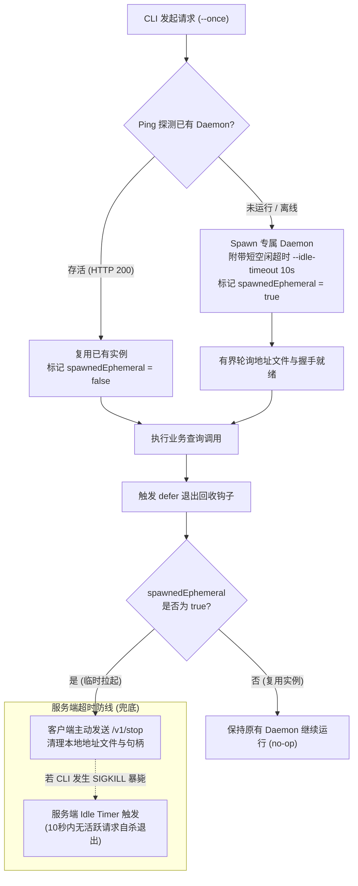

---
name: kb-cli-ephemeral-daemon-lifecycle
description: CLI 工具本地后台服务按需拉起、双重防泄漏兜底与零残留优雅关停流水线。涵盖已有常驻实例探活复用、临时专属 daemon 编排、defer 独立 context 回收、以及服务端短空闲超时自毁保底机制。
version: 1.0.0
created: 2026-10-17
updated: 2026-10-17
---

# dev_flow_073_CLI临时daemon按需拉起与零残留优雅关停

> **条目定位**：Type B 方案与流水线型条目  
> **适用场景**：CLI 工具依赖本地服务/守护进程（如反代、浏览器自动化、耗时缓存或配额抓取），既需要常驻服务的连接复用能力，又需要满足用户单次执行（--once）或开发调试时“查完即走、0 后台进程残留”的工程要求。

---

## 一、业务场景与单次查询痛点

在现代客户端/CLI 工具开发中（如 `agyquota`、AI 辅助套件或数据同步代理），常采用 **Client-Daemon C/S 本地分层架构**：Daemon 负责管理网络连接、Token 刷新或重量级缓存，CLI 仅作为轻量级交互终端。

然而在生产与开发实践中，这种架构面临以下工程痛点：

1. **单次查询成本过高（进程常驻负担）**：
   - 用户往往只想执行一次瞬时查询（如 `cli --status`），查完后常驻后台的守护进程持续霸占端口（如 `17625`）和物理内存（数十至上百 MB），造成隐形资源泄漏；
2. **开发构建态进程冲突与假死**：
   - 开发者修改代码后重新编译，旧版本的常驻守护进程仍在运行，由于端口被独占或内部 BuildID 握手不一致，新编译的 CLI 频繁抛出 `daemon unreachable` 或数据割裂；
3. **僵尸孤儿进程隐患**：
   - 若由 CLI 启动后台子进程，一旦用户在终端执行 `Ctrl+C`、终端窗口被突发关闭或 CLI 发生 panic，拉起的守护进程极易脱敏脱管，沦为永生僵尸进程（Zombie/Orphan Process）。

**核心解决目标**：通过 `--once` 机制与双重防泄漏设计，实现：
- **已有常驻守护进程时**：探活复用，查完即走，绝不破坏外部常驻服务；
- **无守护进程时**：按需拉起临时专属实例，查询完毕通过 `defer` 优雅通知关停并销毁临时文件；
- **突发异常/崩溃时**：服务端短空闲超时（`--idle-timeout 10s`）自毁保底，实现后台 0 残留。

---

## 二、生命周期编排与空闲超时底层机制

完整的按需拉起与回收状态机包含两端协同与两道防线：



### 1. 客户端状态标记与优雅回收（第一道防线）
- 客户端维护内部状态 `spawnedEphemeral bool`：
  - 若 Ping 已存活的实例，标记为 `false`；
  - 若由当前 CLI 进程新孵化（Detached Spawn），标记为 `true`。
- 在 CLI 入口函数挂载 `defer` 终结器：
  ```go
  defer func() {
      if cl.IsEphemeral() {
          // 独立分配 5s 专属 context，防止受父级上下文取消影响导致关停中断
          cleanupCtx, cancel := context.WithTimeout(context.Background(), 5*time.Second)
          defer cancel()
          _ = cl.CleanupIfEphemeral(cleanupCtx)
      }
  }()
  ```

### 2. 服务端空闲超时自毁（第二道兜底防线）
- 如果临时 Daemon 启动后，CLI 进程在 `defer` 执行前被 `kill -9` 强杀、遭遇 OOM 或系统断电，客户端回收逻辑将无法执行；
- 因此服务端启动必须支持传入 `--idle-timeout` 参数。临时拉起时传入短超时（如 `10s`），常驻运行传入长超时（如 `30m` 或 `0` 表示不退出）：
- 服务端维护 `time.Timer`，每当接收到 HTTP 业务请求时重置计时器；连续达到指定时间无请求接入，自动调用 `server.Shutdown` 退出并清理运行时资源。

### 3. 空闲退出瞬态竞态重试（Retryable）
- 若某次请求到达服务端的瞬间，恰好碰上服务端空闲倒计时结束正在关停（HTTP 503 或连接被重置），客户端实现有界幂等单次重试：重新触发 `EnsureDaemon`，再次透明重试该只读请求。

---

## 三、标准自动化流水线与代码实现

以下为 Go 语言中可直接复用的客户端生命周期与关停核心代码骨架：

### 1. 客户端 Client 结构与探测编排实现
```go
package client

import (
	"context"
	"errors"
	"fmt"
	"net/http"
	"os"
	"os/exec"
	"time"
)

type Config struct {
	Host string
	Once bool // 单次查询模式开关
}

type Client struct {
	cfg              Config
	addr             string
	spawnedEphemeral bool // 是否为本次 CLI 临时拉起的专属 daemon
	hc               *http.Client
}

const (
	defaultPort                = 17625
	spawnIdleTimeout           = "30m" // 常驻模式空闲超时
	spawnEphemeralIdleTimeout  = "10s" // 临时模式空闲超时（自毁保底）
	startWait                  = 5 * time.Second
	startPollInterval          = 100 * time.Millisecond
)

func New(cfg Config) *Client {
	return &Client{cfg: cfg, hc: &http.Client{Timeout: 5 * time.Second}}
}

// EnsureDaemon 确保目标守护进程可用：先探活，不可用则按需拉起
func (c *Client) EnsureDaemon(ctx context.Context) error {
	// 1. 优先尝试探测现有 daemon
	if err := c.ping(ctx); err == nil {
		c.spawnedEphemeral = false // 复用已有实例
		return nil
	}

	// 2. 决定空闲超时参数
	idle := spawnIdleTimeout
	if c.cfg.Once {
		idle = spawnEphemeralIdleTimeout
	}

	// 3. 静默拉起子进程（Detached）
	if err := c.spawnDaemonWithIdle(ctx, idle); err != nil {
		return err
	}

	if c.cfg.Once {
		c.spawnedEphemeral = true
	}
	return nil
}

// spawnDaemonWithIdle 孵化后台子进程并等待就绪
func (c *Client) spawnDaemonWithIdle(ctx context.Context, idleTimeout string) error {
	exe, err := os.Executable()
	if err != nil {
		return fmt.Errorf("获取可执行文件路径失败: %w", err)
	}

	cmd := exec.Command(exe, "serve", "--idle-timeout", idleTimeout)
	// 在 Windows 上配置 DETACHED_PROCESS 属性，解除控制台关联
	configureDetached(cmd)

	if err := cmd.Start(); err != nil {
		return fmt.Errorf("启动后台服务失败: %w", err)
	}

	// 异步释放进程追踪，切断生命周期捆绑
	go func() { _ = cmd.Wait() }()

	// 有界轮询探活就绪
	deadline := time.Now().Add(startWait)
	for time.Now().Before(deadline) {
		if err := c.ping(ctx); err == nil {
			return nil
		}
		select {
		case <-ctx.Done():
			return ctx.Err()
		case <-time.After(startPollInterval):
		}
	}
	return errors.New("后台服务启动超时未能及时就绪")
}

// IsEphemeral 报告当前连接是否为临时专属实例
func (c *Client) IsEphemeral() bool {
	return c.spawnedEphemeral
}

// CleanupIfEphemeral 若为临时拉起的实例，发送优雅关停请求
func (c *Client) CleanupIfEphemeral(ctx context.Context) error {
	if !c.spawnedEphemeral {
		return nil // 针对复用的常驻服务，绝对不予关停
	}
	req, err := http.NewRequestWithContext(ctx, http.MethodPost, fmt.Sprintf("http://%s/v1/stop", c.addr), nil)
	if err != nil {
		return err
	}
	resp, err := c.hc.Do(req)
	if err != nil {
		return err
	}
	defer resp.Body.Close()
	return nil
}

func (c *Client) ping(ctx context.Context) error {
	req, err := http.NewRequestWithContext(ctx, http.MethodGet, fmt.Sprintf("http://127.0.0.1:%d/v1/ping", defaultPort), nil)
	if err != nil {
		return err
	}
	resp, err := c.hc.Do(req)
	if err != nil {
		return err
	}
	defer resp.Body.Close()
	if resp.StatusCode != http.StatusOK {
		return fmt.Errorf("HTTP %d", resp.StatusCode)
	}
	c.addr = fmt.Sprintf("127.0.0.1:%d", defaultPort)
	return nil
}
```

### 2. Windows 平台特异性 Detached 句柄分离
```go
//go:build windows

package client

import (
	"os/exec"
	"syscall"
)

func configureDetached(cmd *exec.Cmd) {
	if cmd.SysProcAttr == nil {
		cmd.SysProcAttr = &syscall.SysProcAttr{}
	}
	// 0x00000008: DETACHED_PROCESS, 0x08000000: CREATE_NO_WINDOW
	cmd.SysProcAttr.CreationFlags |= 0x00000008 | 0x08000000
}
```

### 3. CLI 主程序 defer 回收编排（Command 层）
```go
func RunQuery(cmd *cobra.Command, args []string) error {
	once, _ := cmd.Flags().GetBool("once")
	cl := client.New(client.Config{Once: once})

	ctx, cancel := context.WithTimeout(context.Background(), 2*time.Minute)
	defer cancel()

	// 退出保底挂载：执行结束无论成功或错误均触发回收检测
	defer func() {
		if cl.IsEphemeral() {
			cleanupCtx, cleanupCancel := context.WithTimeout(context.Background(), 5*time.Second)
			defer cleanupCancel()
			_ = cl.CleanupIfEphemeral(cleanupCtx)
		}
	}()

	if err := cl.EnsureDaemon(ctx); err != nil {
		return err
	}

	// 执行实际业务查询
	return cl.DoQuery(ctx)
}
```

---

## 四、交付验证断言与防泄漏排查 SOP

在 Windows 环境下验证该机制是否达成 0 残留设计目标：

### 1. 验证场景 A：无守护进程时的单次查询与自动销毁
```powershell
# 1. 确保当前无常驻进程
Get-Process -Name "agyquota" -ErrorAction SilentlyContinue

# 2. 携带 --once 运行单次查询
agyquota --zed --once

# 3. 验证进程退出后后台 0 残留
Get-Process -Name "agyquota" -ErrorAction SilentlyContinue
# 断言：输出为空，无任何残留进程
```

### 2. 验证场景 B：已有常驻服务时的安全复用保护
```powershell
# 1. 在终端 A 启动常驻服务
agyquota serve

# 2. 在终端 B 执行 --once 查询
agyquota --zed --once

# 3. 验证终端 A 的常驻服务未被意外杀掉
Get-Process -Name "agyquota"
# 断言：终端 A 的 serve 守护进程依然正常存活
```

### 3. 验证场景 C：CLI 异常崩溃时的服务端 10s 超时自毁
```powershell
# 1. 模拟启动临时 daemon（传入短空闲超时 10s）
Start-Process -FilePath "agyquota.exe" -ArgumentList "serve", "--idle-timeout", "10s" -NoNewWindow

# 2. 等待 12 秒且不发送任何 HTTP 请求
Start-Sleep -Seconds 12

# 3. 验证是否由 Idle Timer 自动退出
Get-Process -Name "agyquota" -ErrorAction SilentlyContinue
# 断言：进程已自动退出，地址文件已由服务端 defer 自动销毁
```