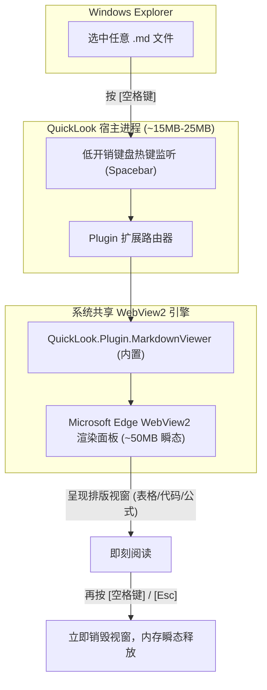

# win_ql_flow_093_QuickLook便携部署与Markdown空格秒览

> **条目定位**：**Type B 工程方案流水线（Typora 高内存替代 × Windows 空格即时预览工作流）**  
> **痛点直击**：Typora/Obsidian 在纯阅读场景下打开 3 个窗口即吞噬 800MB~1.2GB 内存；多窗口常驻任务栏杂乱；双击打开/关闭流程笨重。  
> **方案核心**：部署 QuickLook 绿色便携版（v4.5.0+），利用原生内置的 `MarkdownViewer` 插件与 Windows 系统共享的 WebView2 运行时，实现 **“空格秒开、方向键连翻、阅后即焚、后台仅占 15MB”** 的极速预览体验。  
> **验证环境**：Windows 11 23H2/24H2、Microsoft Edge WebView2 Runtime、QuickLook 4.5.0 Portable（`D:\Users\Softwares\QuickLook\`）。

---

## 一、业务场景与痛点根因

### 1. Typora / Electron 工具的内存原罪
在日常技术文档查阅、代码仓库 README 审阅或配置核对场景中，用户只需要 **“纯阅读与样式渲染”**，无需重度知识图谱（PKM）或所见即所得实时编辑。

然而 Typora 等传统工具基于 Electron 架构，多开窗口存在不可逆的内存放大效应：
1. **多进程独立堆栈**：双击打开 3 个 `.md` 文件，Chromium 宿主会拉起 1 个 Browser 主进程 (~150MB)、1 个 GPU 进程 (~100MB) 以及 **3 个独立的 Renderer 渲染进程（每个 ~200MB-260MB）**；
2. **重度运行时无法复用**：每个窗口独占完整的 V8 JavaScript 虚拟机实例、MathJax 解析管线、Mermaid 渲染引擎与 CodeMirror 编辑器实例，底层内存池完全隔离；
3. **实测开销**：3 个独立窗口内存常态化逼近 **800MB ~ 1050MB**，造成严重的系统资源浪费与任务栏窗口堆积。

### 2. 传统替代方案的缺陷对比
* **浏览器扩展方案（Edge/Chrome + Markdown Viewer）**：虽然复用浏览器内存，但存在本地磁盘文件访问限制（必须手动开启 `file://` 权限）、标签页与日常网页混杂缺乏桌面独立感、快捷键受限等硬伤；
* **双链笔记（Obsidian/Logseq）**：同样为 Electron 底座，启动强制加载本地索引、插件沙箱和双链图谱，内存开销比 Typora 更甚；
* **Zed (Windows 版)**：目前 Windows 下 Markdown 预览处于实验阶段，且官方存在 Issue #39914 内存泄漏（预览内存飙升至 2GB+ 无法释放），暂不宜选为主力阅读器。

---

## 二、底层架构与选型优势（Why QuickLook + WebView2）

QuickLook 借鉴 macOS 原生“空格快速预览（Quick Look）”交互范式，其底层架构完全契合低开销阅读诉求：



### 核心指标对比

| 指标维度 | Typora (3 独立窗口) | 浏览器扩展方案 | QuickLook 瞬态预览 |
| :--- | :--- | :--- | :--- |
| **平时常驻内存** | 0 MB (未启动时) | 0 MB (宿主常驻) | **~15MB - 25MB** (托盘监听服务) |
| **阅读 3 篇文档开销** | **~850MB - 1050MB** | ~70MB (3 个 Tab) | **~50MB - 80MB** (单瞬态视窗，销毁即释放) |
| **打开/关闭流程** | 双击文件 -> 等待加载 -> 点叉关闭 | 双击关联 -> 跳浏览器新标签 | **空格秒开 -> 空格/Esc 秒关** |
| **同目录翻页** | 需在资源管理器反复双击新文件 | 需逐个在浏览器打开 | **窗口不关，按方向键 `↑` `↓` 秒切下个文件** |
| **支持文件类型** | 仅限 Markdown | 仅限 Markdown / Web | **全能：MD、图片、PDF、代码、CSV、ZIP 等** |

---

## 三、便携部署与配置落地 SOP

本方案采用**完全免安装的绿色便携部署（Portable Mode）**，所有配置与缓存严格收敛在当前目录，不写注册表，方便全机迁移。

### 1. 目录规划与便携锁
标准落位路径：`D:\Users\Softwares\QuickLook\`。  
便携版的核心标志是根目录下存在 `portable.lock` 文件：只要该文件存在，QuickLook 就会将配置重定向至当前目录下的数据文件夹，绝不污染 `%APPDATA%`。

### 2. 自动化下载与解压脚本（PowerShell）

```powershell
$installDir = "D:\Users\Softwares\QuickLook"
if (-not (Test-Path $installDir)) { New-Item -ItemType Directory -Path $installDir -Force | Out-Null }

# 1. 下载官方绿色便携包 (v4.5.0，约 62MB)
$url = "https://github.com/QL-Win/QuickLook/releases/download/4.5.0/QuickLook-4.5.0.7z"
$archive = Join-Path $installDir "QuickLook-4.5.0.7z"
Invoke-WebRequest -Uri $url -OutFile $archive -UseBasicParsing

# 2. 解压到目标便携目录 (依赖本机 7z 或 tar)
$7zPath = "D:\Program Files (x86)\Lua\5.1\7z.exe" # 按本机 7z 路径适配
if (Test-Path $7zPath) {
    & $7zPath x $archive -o"$installDir" -y
} else {
    tar -xf $archive -C "$installDir"
}

# 3. 清理压缩包缓存
Remove-Item $archive -Force
```

### 3. 插件自检（关键保障）
QuickLook 从 v4.5.0 开始，核心查看器均已直接原生内置于 `QuickLook.Plugin/` 目录下。落盘后检查以下子目录是否存在：
```powershell
Test-Path "D:\Users\Softwares\QuickLook\QuickLook.Plugin\QuickLook.Plugin.MarkdownViewer"
# 返回 True 即代表 Markdown 预览开箱即用，无需第三方 .qlplugin 文件
```

### 4. 开机自启配置
1. 双击运行 `D:\Users\Softwares\QuickLook\QuickLook.exe`；
2. 任务栏右下角通知区域会出现**蓝色眼睛托盘图标**；
3. **右键托盘图标 ➔ 勾选「开机启动」（Run at Startup）**。  
   *(便携版会向 `HKCU:\Software\Microsoft\Windows\CurrentVersion\Run` 写入当前路径启动项，开机静默常驻，占用内存仅 ~15MB)*。

---

## 四、高效阅读工作流与快捷键指南

| 动作 | 快捷键 / 操作 | 体验效果 |
| :--- | :--- | :--- |
| **瞬时预览** | 鼠标单选文件 ➔ **`Space`（空格）** | 屏幕中央瞬间弹出渲染视窗，免除双击与等待 |
| **阅后即焚** | 预览状态下 ➔ **`Space` 或 `Esc`** | 窗口立即销毁关闭，不占用任务栏 |
| **连翻切文档** | 预览状态下 ➔ **键盘方向键 `↑` `↓` `←` `→`** | 视窗不关闭，毫秒级切换渲染同目录下下一个文档 |
| **固定在最前** | 点击窗口右上角 **「小图钉（Pin）」** 图标 | 窗口置顶锁定，不会因失去焦点而消失，适合对照编写 |
| **全屏沉浸** | 快捷键 **`F11`** | 最大化视窗，无边框专注阅读长篇 Markdown |
| **打开外部应用** | 快捷键 **`Enter`** 或右上角「打开方式」 | 一键调用默认编辑器（如 Typora/VSCode）进行深入编辑 |

---

## 五、避坑指南与极限排障

### 1. 现象：按空格键弹出空白窗口或报错缺失 WebView2
* **根因**：QuickLook 的 MarkdownViewer 依赖 Windows 统一的 **Microsoft Edge WebView2 Runtime**。Windows 11 及更新后的 Windows 10 系统默认内置；部分深度精简版（LTSC / Ghost）系统可能剔除了该运行时。
* **排查命令**：
  ```powershell
  Get-ItemProperty "HKLM:\SOFTWARE\WOW6432Node\Microsoft\EdgeUpdate\Clients\{F3017226-FE2A-4295-8BDF-00C3A9A7E4C5}" -ErrorAction SilentlyContinue | Select-Object pv
  ```
* **救火修复**：若无版本号输出，直接运行以下命令静默安装微软官方 Evergreen 运行时：
  ```powershell
  winget install Microsoft.EdgeWebView2Runtime
  ```

### 2. 现象：在桌面或资源管理器中单按空格键偶发无反应
* **根因 1（快捷键冲突）**：某些划词工具、输入法或 Everything 设置了全局空格热键抢占；
* **根因 2（UI 焦点丢失）**：鼠标点击了资源管理器的空白边缘，当前焦点未停留在具体的 `.md` 文件条目上；
* **规范操作**：鼠标左键单击文件文件名高亮后，再敲击空格。

### 3. 方案边界与反模式提醒
* **反模式**：不要试图把 QuickLook 当作重度文本编辑器使用。它专为“只读、速查、核对、连翻”优化；
* **协同标准**：
  - **90% 的查阅需求**：使用 **QuickLook 空格秒看**；
  - **10% 的编辑与写作需求**：按 `Enter` 唤起专业编辑器，分工明确，彻底摆脱 1GB 内存负担。
