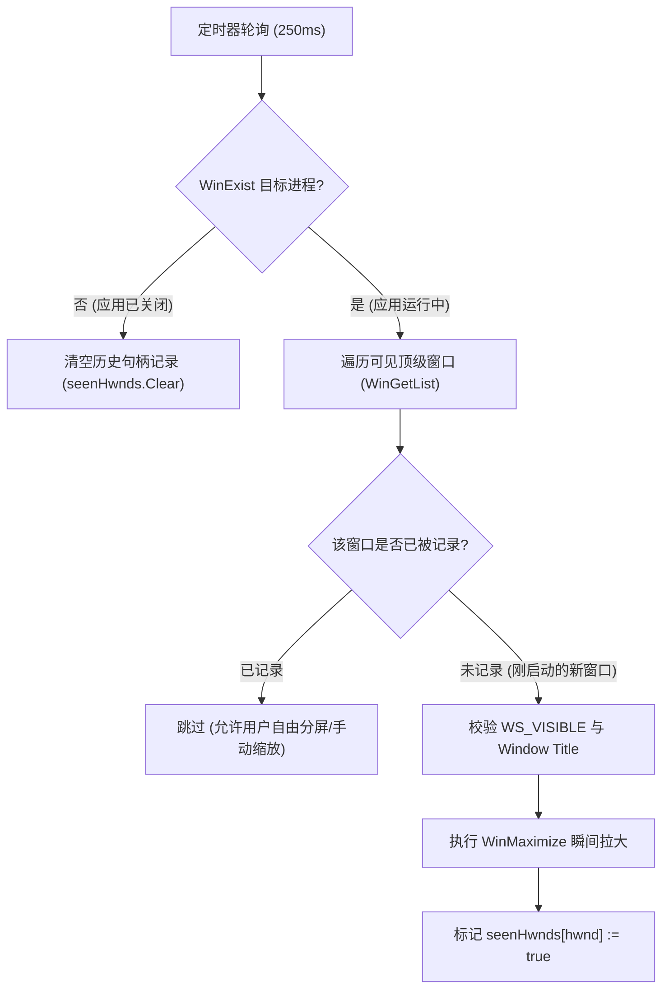

# Windows 非侵入式 AHK 启动外挂与极客桌面自动化全景 (AutoHotkey v2)

> **核心哲学**：不修改目标程序源码、不依赖 DLL 注入、不惧客户端静默自动更新。站在 Win32 消息流、低级输入钩子与 DWM 桌面窗口管理器全局视角，实现毫秒级桌面体验缝合与无感自动化。

---

## 一、非侵入式窗口外挂设计模式：以 Antigravity 启动自动最大化为例

### 1. 痛点场景
部分现代化 Electron / Webview 桌面应用（如 Google Antigravity、某些自研工具）在早期版本中常有以下缺陷：
- 启动时在主进程 `BrowserWindow` 中硬编码了固定尺寸（如 `1400x900` 居中）；
- 由于主进程存储模块采用异步 `fs/promises` 设计，无法在同步创建窗口时无缝注入上次保存的最大化状态，导致窗口**每次打开都无法记忆最大化**；
- 若直接解包修改 `app.asar`，客户端一旦收到静默自动更新，修补文件就会被整包覆盖失效。

### 2. AHK 外部守卫状态机设计
外挂的核心原则是：**“只在启动露面瞬间服务一次，绝不干扰用户日常分屏与手动缩放”**。



### 3. 生产级 AHK v2 实现源码

```autohotkey
; ========================================================
; 全局启动守卫：Antigravity 启动自动最大化外挂 (零侵入)
; ========================================================
SetTimer(AutoMaximizeAntigravity, 250)

AutoMaximizeAntigravity() {
    static seenHwnds := Map()
    target := "ahk_exe Antigravity.exe"
    
    ; 1. 软件未运行：自动重置记录池
    if !WinExist(target) {
        if (seenHwnds.Count > 0) {
            seenHwnds.Clear()
        }
        return
    }

    try {
        ; 2. 遍历该进程下的所有窗口句柄
        for hwnd in WinGetList(target) {
            if !seenHwnds.Has(hwnd) {
                style := WinGetStyle("ahk_id " hwnd)
                ; WS_VISIBLE (0x10000000) 确保窗口已完成绘制并显现
                if (style & 0x10000000) {
                    title := WinGetTitle("ahk_id " hwnd)
                    ; 排除隐藏辅助进程窗口与开发者工具弹窗
                    if (title != "" && InStr(title, "Antigravity")) {
                        WinMaximize("ahk_id " hwnd)
                        seenHwnds[hwnd] := true ; 登记指纹，后续手动缩小不再重复触发
                    }
                }
            }
        }
    }
}
```

### 4. 衍生实战：针对后台 CLI / MCP 子进程弹出 conhost.exe 黑框的无感最小化守卫

#### 痛点根因：
在 Windows 11 下，当后台进程（如 `agy.exe`、Node.js 守护、MCP 工具、Git 钩子）启动子进程时，若父进程未传递 `CREATE_NO_WINDOW (0x08000000)` 或 `windowsHide: true`，且当前系统未将 Windows Terminal 设为系统默认终端（或便携版 WT 控制台委托断层），Windows 会强制为每个 CLI 进程唤起独立的 `conhost.exe` 黑色控制台窗口，直接遮挡当前屏幕并抢走前台输入焦点。

#### 焦点保护与静默最小化方案：
```autohotkey
; conhost 控制台黑框后台无感最小化守卫 (100ms 快速响应，零打扰零抢焦点)
SetTimer(AutoMinimizeConhost, 100)

AutoMinimizeConhost() {
    static handledHwnds := Map()
    static lastUserWindow := 0
    target := "ahk_class ConsoleWindowClass"

    ; 实时捕获用户当前正常操作的前台工作窗口 (排除自身是控制台的情况)
    try {
        if (activeHwnd := WinActive("A")) {
            if (WinGetClass("ahk_id " activeHwnd) != "ConsoleWindowClass") {
                lastUserWindow := activeHwnd
            }
        }
    }

    if !WinExist(target) {
        if (handledHwnds.Count > 0) {
            handledHwnds.Clear()
        }
        return
    }

    try {
        for hwnd in WinGetList(target) {
            ; 只要遍历过，立刻登记指纹，杜绝重复检查与日志膨胀
            if !handledHwnds.Has(hwnd) {
                handledHwnds[hwnd] := true
                
                ; WinGetMinMax: 0 = 正常, 1 = 最大化, -1 = 最小化
                minState := WinGetMinMax("ahk_id " hwnd)
                if (minState != -1) {
                    wasActive := (WinActive("A") = hwnd)
                    
                    ; 瞬间最小化到任务栏 (桌面清爽，不丢失控制台进程)
                    WinMinimize("ahk_id " hwnd)

                    ; 若万一在微秒间被黑框偷走了焦点，立即归还给用户原工作窗口，打字 100% 连贯
                    if (wasActive && lastUserWindow && WinExist("ahk_id " lastUserWindow)) {
                        WinActivate("ahk_id " lastUserWindow)
                    }
                }
            }
        }
    }
}
```

---

## 二、Windows 终端下 AHK 进程 WMI 脱离无感热重载 SOP

### 1. 终端与 Job Object 误杀陷阱
在开发自动化脚本、通过 Agent 或 CI 终端远程修改 AHK 脚本后，常规的 `Start-Process` 或 `& AutoHotkey.exe` 会导致以下灾难：
- 命令行子进程退出时，Windows **Job Object** 会将依附于该终端树的所有子进程（包括 AHK）连带强行杀死；
- 传递 `/restart` 时可能受到提权对话框或会话隔离阻断。

### 2. 标准无感脱离重载流水线（PowerShell）
利用 WMI `Win32_Process.Create` 机制，创建与当前终端父进程完全脱离的独立后台守护：

```powershell
# 1. 优雅终止旧实例
Stop-Process -Name AutoHotkey64 -Force -ErrorAction SilentlyContinue

# 2. 构造启动命令行（务必保持纯正引号转义）
$ahkExe = "$env:LOCALAPPDATA\Programs\AutoHotkey\v2\AutoHotkey64.exe"
$scriptPath = "$env:APPDATA\Microsoft\Windows\Start Menu\Programs\Startup\app_switcher.ahk"
$cmd = "`"$ahkExe`" `"$scriptPath`""

# 3. 通过 WMI CIM 方法脱离创建独立守护进程
$result = Invoke-CimMethod -ClassName Win32_Process -MethodName Create -Arguments @{ CommandLine = $cmd }

if ($result.ReturnValue -eq 0) {
    Write-Host "[✔] AutoHotkey 已无感热重启成功，PID: $($result.ProcessId)" -ForegroundColor Green
} else {
    Write-Error "启动失败，WMI 返回码: $($result.ReturnValue)"
}
```

---

## 三、AutoHotkey 极客能力全景（面向开发者与 AI 的分类版图）

AutoHotkey 绝非单纯的“改键器”，它本质是一个专为 Windows 打造的**无头操作系统事件与窗口总线**。以下是其五大核心工程应用场景：

| 能力维度 | 核心机制 | 典型落地场景 | 核心 API / 范例 |
| :--- | :--- | :--- | :--- |
| **1. 窗口工效学 (Window Ergonomics)** | DWM 窗口消息、句柄状态机 | 启动姿态自动纠偏、抽屉式切换（Toggle）、多屏瞬移、置顶钉住、透明度调节 | `WinMaximize`, `WinMove`, `WinSetAlwaysOnTop`, `WinSetTransparent` |
| **2. 键盘与输入流魔改 (Keyboard Augmentation)** | 低级键盘钩子 (WH_KEYBOARD_LL) | CapsLock 封神全局方向键（HJKL）、消除 Alt+Tab 粘滞、修饰键死锁应急复位 | `#HotIf`, `A_MenuMaskKey := "vkE8"`, `GetKeyState` |
| **3. 智能文本与宏扩展 (Hotstrings)** | 字符输入流替换缓冲区 | 邮箱/日期/结构化 SQL/代码模板毫秒级展开、输入法联动、防误触触发 | `:*:;mail::user@domain.com`, `:*:;date::...` |
| **4. 剪贴板管道流 (Clipboard Pipeline)** | `OnClipboardChange` 钩子 | 自动剥离恶心富文本与样式、自动剔除 URL 营销跟踪追踪参数（UTM）、JSON/YAML 快速管道清洗 | `A_Clipboard := A_Clipboard`, 正则清洗过滤 |
| **5. 上下文隔离与控制 (Context Sensitivity)** | 进程名/窗口类条件编译 | 针对特定 IDE / 浏览器配置独立键位映射，在后台无激活状态下向特定窗口发指令 | `#HotIf WinActive("ahk_exe chrome.exe")`, `ControlClick`, `ControlSend` |

---

### 场景详解与经典模式

#### 1. CapsLock 封神：打字手不离字母区的全局方向键
```autohotkey
; 按住 CapsLock + HJKL 映射为方向键，打字手腕不移位
#HotIf GetKeyState("CapsLock", "P")
h::Left
j::Down
k::Up
l::Right
u::Home
o::End
i::PgUp
m::PgDn
#HotIf

; 短按 CapsLock 为 Esc，长按/组合键维持功能
*CapsLock:: {
    KeyWait "CapsLock"
    if (A_PriorKey = "CapsLock") {
        Send "{Esc}"
    }
}
```

#### 2. 全局窗口钉住与半透明化
```autohotkey
; Ctrl + Space: 切换当前活动窗口的“永远置顶 (Always-On-Top)”
^Space::WinSetAlwaysOnTop(-1, "A")

; Win + 滚轮上/下: 调节当前窗口透明度 (150 ~ 255)
#WheelUp:: {
    current := WinGetTransparent("A") || 255
    WinSetTransparent(Min(255, current + 25), "A")
}
#WheelDown:: {
    current := WinGetTransparent("A") || 255
    WinSetTransparent(Max(100, current - 25), "A")
}
```

#### 3. 剪贴板自动去除追踪尾巴 (Clean URL Pipeline)
```autohotkey
OnClipboardChange(CleanTrackingParameters)

CleanTrackingParameters(DataType) {
    if (DataType != 1) return ; 仅处理纯文本
    text := A_Clipboard
    if RegExMatch(text, "^https?://") {
        ; 剔除常见的 utm_*, spm, fbclid 等追踪参数
        cleaned := RegExReplace(text, "(\?|&)(utm_[^&=]+|spm|fbclid|from_source)=[^&=]+", "")
        cleaned := RegExReplace(cleaned, "\?&", "?")
        cleaned := RegExReplace(cleaned, "(&+)$", "")
        cleaned := RegExReplace(cleaned, "\?$", "")
        if (cleaned != text) {
            A_Clipboard := cleaned
        }
    }
}
```

---

## 四、工程验收与运维标准

1. **运行时资源开销**：
   - 进程：`AutoHotkey64.exe`
   - 内存占用：常驻约 `2 MB ~ 4 MB`；
   - CPU 占用：空闲与 250ms 定时器状态下稳定为 `0.00%`。
2. **开机自启路径**：
   - 标准部署路径：`%APPDATA%\Microsoft\Windows\Start Menu\Programs\Startup\app_switcher.ahk`。
3. **升级兼容性保证**：
   - 本外挂与目标软件底层二进制解耦，目标应用（Antigravity、VSCode 等）版本升级无需重复配置，永久保持生效。
