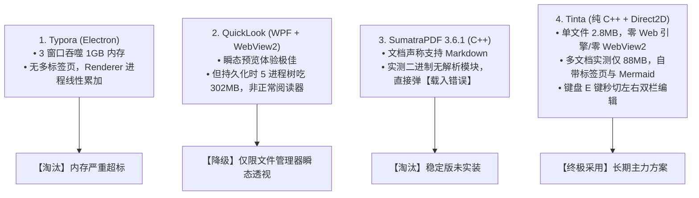

# win_tinta_flow_097_Tinta原生极轻Markdown阅读与双栏编辑

> **条目定位**：**Type B 工程方案流水线（Typora 高内存替代终极方案 × 原生 Direct2D 极轻阅读与双栏编辑）**  
> **痛点直击**：Typora 打开 3 个窗口吞噬 1GB 内存；QuickLook 常驻时 WebView2 进程树达 302MB 且无法持久多文档组织；SumatraPDF 稳定版打开 `.md` 报“载入错误”。  
> **方案核心**：部署基于纯 C++ 开发、Direct2D 显卡硬解的独立单文件应用 **Tinta（2.8MB）**。彻底斩断 Chromium 与 Node.js 链条，多文档实测仅 **88MB**，兼备原生多标签、Mermaid 矢量图、暗黑主题、`E` 键即时双栏编辑与 `Ctrl+V` 截图自动落盘。  
> **落盘路径**：`D:\Users\Softwares\Tinta\tinta.exe`（绿色便携锁 `settings.ini`）。

---

## 一、技术选型演进与终极定位

在寻找轻量 Markdown 阅读器的过程中，经历了四轮技术路线的实测交锋与去伪存真：



### 核心对比基准

| 指标维度 | Typora (3 独立窗口) | QuickLook (持久驻留) | Tinta (多文档实测) |
| :--- | :--- | :--- | :--- |
| **底层架构** | Electron (Chromium + Node.js) | WPF + Microsoft Edge WebView2 | **纯 C++ + Direct2D / DirectWrite** |
| **进程数量** | 3 个顶级窗口，5+ 个进程 | 1 个 WPF + 4 个 WebView2 进程树 | **单进程（仅 1 个 `tinta.exe`）** |
| **多文档总内存** | **~850MB - 1050MB (近 1GB)** | **~302MB (单个窗口)** | **仅 88.4 MB（多标签并发）** |
| **冷启动速度** | ~1.5s - 2.5s | ~0.8s | **< 100ms（毫秒级秒开）** |
| **持久文档管理** | 无标签页，窗口散落任务栏 | 无标签页，点其他窗口易失焦 | **Win11 风格标签页，支持撕出/合并窗口** |
| **编辑支持** | 所见即所得（重度内存） | 仅只读预览 | **`E` 键瞬切双栏联动编辑，`Ctrl+V` 贴图自动落盘** |

---

## 二、底层架构与低内存机制

### 1. 为什么 Chromium 类工具（Typora/WebView2）必然逼近 300MB~1GB？
Chromium 为了安全沙箱与多标签崩溃隔离，强制采用多进程流水线：
* **GPU 合成进程**： DirectWrite 字体栅格化与 DirectX 交换链，基础底噪 **80MB~100MB**；
* **V8 虚拟机堆栈**： JavaScript 运行时与 GC 堆内存，单实例 **50MB~80MB**；
* **Renderer 渲染管线**： Blink 引擎 DOM/CSSOM 树构建，单实例 **100MB~150MB**；
* Typora 缺乏多标签架构，每开一个新窗口就克隆一套上述进程，3 窗口必然吞噬 1GB。

### 2. Tinta 的“极致轻量”底层原理解析
* **Direct2D 原生矢量排版**：Tinta 彻底废弃 HTML DOM 树，直接调用 Windows 系统的 `d2d1.dll` 与 `dwrite.dll`，文字排版与图形图元由 GPU 直接进行硬件加速计算，**内存开销直接下降一个数量级**；
* **单进程多文档共享模型**：打开 1 个文档与打开 5 个文档，共用同一套 Direct2D 显卡渲染管道，新文档仅增加纯粹的 AST 抽象语法树内存（每个文档仅占数 MB），彻底根绝进程放大效应；
* **零后台开销**：无 JS 引擎定时器轮询，静置阅读时 CPU 占用稳定为 **0.0%**。

---

## 三、绿色便携化部署（Portable SOP）

本方案落盘于 `D:\Users\Softwares\Tinta\`，配置 100% 绿色便携，迁移无需重装：

### 1. 便携部署路径
```text
D:\Users\Softwares\Tinta\
├── tinta.exe        # 官方单文件可执行程序 (2.8 MB)
└── settings.ini     # 便携引导锁 (声明后所有配置/主题/草稿皆留在本目录，不污染 AppData)
```

### 2. 自动化部署脚本（PowerShell）
```powershell
$tintaDir = "D:\Users\Softwares\Tinta"
if (-not (Test-Path $tintaDir)) { New-Item -ItemType Directory -Path $tintaDir -Force | Out-Null }

# 1. 下载官方绿色便携版 (v3.9.0+)
$url = "https://github.com/oipoistar/tinta/releases/download/v3.9.0/tinta.exe"
$exePath = Join-Path $tintaDir "tinta.exe"
Invoke-WebRequest -Uri $url -OutFile $exePath -UseBasicParsing

# 2. 创建便携引导文件（关键：锁定当前目录）
$iniPath = Join-Path $tintaDir "settings.ini"
if (-not (Test-Path $iniPath)) { New-Item -ItemType File -Path $iniPath -Force | Out-Null }
```

### 3. Windows 全局默认打开关联
1. 在文件资源管理器中，右键任意 `.md` 文件 ➔ **「打开方式」** ➔ **「选择其他应用」**；
2. 点击 **「在电脑上选择应用」** ➔ 浏览定位至 `D:\Users\Softwares\Tinta\tinta.exe`；
3. 勾选 **「始终使用此应用打开 .md 文件」**。

---

## 四、💡 人类极速阅读与高效使用指南（面向日常查阅与编写）

本章专门为人类用户编写，涵盖日常技术文档查阅与快速修改的全部核心技巧。

### 4.1 核心快捷键速查表（阅读 vs 编辑）

| 使用场景 | 快捷键 | 动作效果 |
| :--- | :--- | :--- |
| **模式切换** | **`E`**（或 `:`） | **进入双栏编辑模式**（左侧源码，右侧实时排版） |
| | **`Esc` `Esc`**（连按两次） | **退出编辑，返回纯净全宽阅读视图** |
| **文档保存** | **`Ctrl + S`** | 保存当前修改（未保存文件标签页带小圆点 `●`） |
| **专注写作** | **`Ctrl + E`** | 编辑模式下隐藏右侧预览面板，开启单栏专注纯文本 |
| **大纲目录** | **`Tab`** | 呼出/隐藏侧边栏大纲目录（TOC），点击快速锚点跳转 |
| **主题切换** | **`T`** | 弹出主题选择器（内置 5 款亮色 + 5 款暗黑护眼主题） |
| **文本搜索** | **`F`** 或 **`Ctrl + F`** | 当前文档查找（匹配项在右侧滚动条上显示标记刻度） |
| **全库穿透搜索** | **`Ctrl + Shift + F`** | 跨所有打开的标签页与当前文件夹全量搜索 |
| **页面缩放** | **`Ctrl + 鼠标滚轮`** | 无级缩放字号排版 |
| **图片灯箱** | **鼠标左键单击图片** | 弹出全屏图片灯箱，支持滚轮无级缩放与拖拽平移 |

---

### 4.2 极速阅读三板斧

1. **大纲极速定位（按 `Tab` 键）**：
   阅读长篇架构方案或 API 文档时，直接敲一下键盘 **`Tab`** 即可在左侧呼出完整大纲树，点击任意章节毫秒级平滑滚动定位；
2. **夜间护眼配色（按 `T` 键）**：
   敲一下键盘 **`T`**，上下方向键挑选主题：
   * 日间推荐：**`Paper`**（纸质书本微黄护眼排版）；
   * 夜间推荐：**`Midnight`** 或 **`Obsidian`**（深灰背景，高对比度代码配色）；
3. **架构大图精细查阅（单击图片）**：
   文档里的高分辨率架构图或流程图，无需右键另存为，**鼠标单击该图片**即可进入全屏灯箱：
   * 鼠标滚轮放大至 400%；
   * 鼠标拖拽平移视口；
   * 按 `Esc` 退出灯箱回到阅读位置。

---

### 4.3 灵动双栏编辑与快捷编写

* **随时随地就地微调**：
  看文档发现写错了或想顺手加几行配置，不用特意调用外部笨重的 IDE，**单按键盘 `E` 键**，界面立即平滑展开为左右分栏；
* **光标聚焦联动**：
  在左侧敲代码或文字时，右侧预览面板对应的段落会自动加上一层淡雅的高亮框，永远不会迷失当前写到哪段；
* **临时全宽预览**：
  在编辑过程中若想临时看一下全宽的最终效果，按 **`Ctrl + Shift + E`** 即可全屏预览未保存内容，按 `Esc` 瞬间返回光标位置。

---

### 4.4 杀手级效率技巧

#### 技巧 1：剪贴板截图一键存图（超省心插图）
在编辑模式下，使用任何截图工具（微信/Snipaste/Windows 自带 `Win+Shift+S`）截完图后，**直接按 `Ctrl + V`**：
* Tinta 自动在当前 `.md` 所在的同级目录下生成一张唯一的 `.png` 文件；
* 并在光标处自动插入标准的 Markdown 图片语法：``；
* 彻底告别手动保存图片、重命名、敲路径的繁琐步骤。

#### 技巧 2：程序员级多光标与表格对齐
* **批量修改变量名**：光标选中某个词，连续按 **`Ctrl + D`**，会自动把下方所有同名单词逐一加入多光标，一次敲键盘同时修改多处；
* **批量对齐列**：按住 **`Alt` + 鼠标纵向拖拽**，拉出一整列光标，批量给 Markdown 表格补齐空格或竖线 `|`。

#### 技巧 3：选区符号自动两头包裹
在编辑源码时，鼠标选中文本后：
* 敲键盘 **`*`** ➔ 自动变成粗体 `**选中文本**`；
* 敲键盘 **`~`** ➔ 自动变成删除线 `~~选中文本~~`；
* 敲键盘 **`[`** ➔ 自动变成链接 `[选中文本]()`；
* 敲键盘 **`"`** ➔ 自动加上双引号。

#### 技巧 4：防手残草稿自动保护（Draft Recovery）
如果不小心手滑关闭了窗口，或者系统断电关机，Tinta 在后台实时维护了草稿缓存；重新启动时会自动提示检测到未保存的变更，点击即可一键恢复，杜绝内容丢失。

---

### 4.5 标签页（Tabs）管理秘籍

Tinta 完整还原了 Windows 11 记事本风格的现代多标签页：
* **打开方式**：资源管理器中双击打开多个 `.md`，默认全部汇入同一个 Tinta 窗口并排展示；
* **标签切换**：快捷键 **`Ctrl + Tab`** 顺次切换标签；
* **关闭标签**：鼠标中键单击标签，或按 **`Ctrl + F4`**（阅读模式下也可按 `Ctrl + W`）；
* **窗口拆分与合并**：
  * **撕出窗口**：按住某个标签页往外一拖，即可将其撕出一个独立的桌面新窗口；
  * **吸附合并**：把单独的窗口拖回另一个窗口的标签栏区域，自动重新吸附为标签页。

---

### 4.6 系统级极速呼出与抽屉式盲切（AutoHotkey 集成）

为彻底解决“想查阅文档或临时草稿时每次都要从任务栏瞄准翻找”的痛点，Tinta 已无缝接入系统的 AutoHotkey v2 单手盲切体系（详见 `014_win_ahk_flow_Win单手盲切与抽屉式Toggle窗口AHK配置.md`）：

- **全局快捷键**：<kbd>Alt</kbd> + <kbd>T</kbd>（对应 Tinta 首字母，脚本兼容 `tinta.exe` 与 `tina.exe`）；
- **核心状态机**：
  1. **未运行时秒级拉起**：若进程未驻留，按下直接冷启动 `D:\Users\Softwares\Tinta\tinta.exe`（<100ms 极速秒开）；
  2. **在后台瞬间置顶**：在任何 IDE、浏览器或终端中按下，立即将 Tinta 置顶激活并获取焦点；
  3. **在前台抽屉式收起**：再次按下相同的 <kbd>Alt</kbd> + <kbd>T</kbd> 瞬间最小化收回任务栏，呼之即来、挥之即去；
  4. **多窗口轮替漫游**：当撕出多个 Tinta 独立窗口时，连续按下可顺次轮流聚焦各个窗口，巡视一圈后自动最小化。

---

## 五、避坑指南与极限自检

1. **首次启动关联弹窗处理**：
   首次双击 `tinta.exe` 时会弹出系统问询框：“是否将 Tinta 设为 Markdown 查看器？”：
   * 点“是”：自动调用系统设置完成协议关联；
   * 点“否”：直接进入主窗口，不修改系统设置。
2. **纯便携模式判定**：
   确认 `D:\Users\Softwares\Tinta\settings.ini` 文件存在。一旦存在，Tinta 不会在 `%APPDATA%\Tinta` 生成任何配置文件，U 盘打包即走。
3. **Mermaid 离线渲染支持**：
   Tinta 内置了纯 C++ 编写的 Mermaid 离线解析引擎，支持 22 类常见图表（flowchart、sequence、class、state、er、gantt、pie 等），断网环境下完全正常绘制矢量图形。
