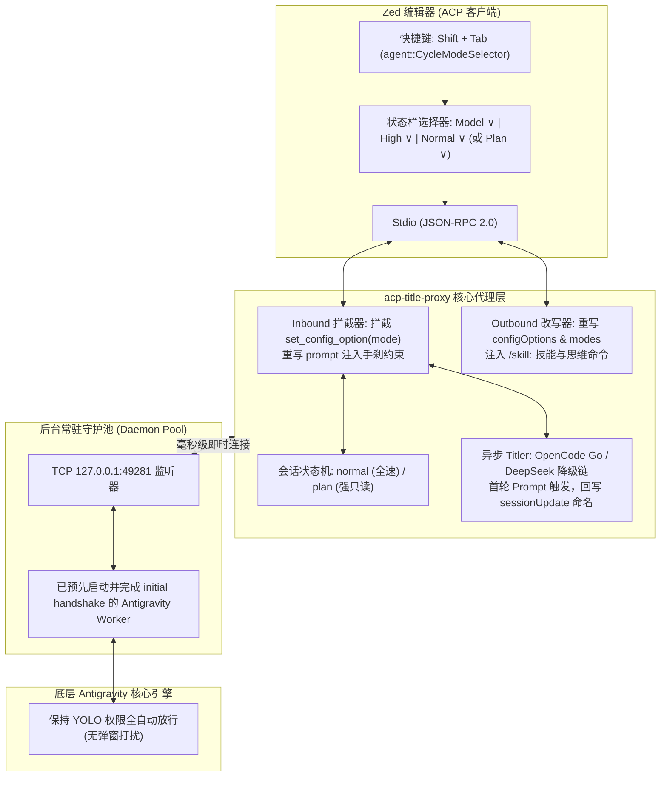

# agent_acp_flow_106_ACP代理架构与ZedMode拦截及默认YOLO安全手刹

> **条目定位**：**Type B 方案流水线与架构设计条目（Zed ACP 协议透明代理 × 预热池 × Mode 选项劫持与安全手刹解耦）**  
> **危险评级**：★★☆☆☆（配置或拦截不当可能导致 Zed 无法加载 ACP 会话、反序列化崩溃、或 Shift+Tab 循环卡死在原生选项）  
> **验证环境**：Windows 11、Zed v0.158+、Go 1.23+、`acp-title-proxy`、Google Antigravity ACP (v1.4.4)。  
> **关联条目**：Zed 外部 ACP 线程自动命名见 `077_ide_zed_fix_Zed外部ACP线程不自动命名与首消息标题链路.md`；自定义 ACP 图标见 `076_ide_zed_fix_Zed自定义ACP代理图标机制与注册表兜底.md`；长会话生成完毕卡死见 `083_ide_zed_fix_Zed外接ACP长会话生成完毕转圈卡死与PromptResponse丢失排障.md`。

---

## 一、现象与痛点直击

开发者在 Zed 编辑器中使用外部 Agent（如 Google Antigravity、OpenCode）时，普遍遭遇三大交互与控制痛点：

### 1. 痛点一：外部 ACP 会话标题永远是占位符
* **现象**：内置的 Zed Agent 能够自动根据首条消息提炼出简短精炼的中文标题，而通过 `agent_servers` 接入的外部 ACP Agent，标签页标题永远是冰冷的 `New Google Antigravity Thread` 或 `New Thread`，无法追溯历史。

### 2. 痛点二：权限确认与防误改的“两难困境”
* **Default 模式痛点**：默认权限模式下，AI 每跑一条终端命令、每读写一个文件都要弹窗等待人工批准，严重撕裂编码心流；
* **YOLO 模式隐患**：如果全局开启 `mode: "yolo"`（完全免审批自动放行），在向 AI 提出宽泛需求或探索性讨论时，AI 经常“自作主张”直接大改本地代码库，缺少类似 OpenCode 那样轻便安全的“只读方案手刹”。

### 3. 痛点三：`Shift + Tab` 快捷键无法切换 Plan 模式
* **现象**：Zed 默认提供了 `Shift + Tab`（绑定的动作为 `agent::CycleModeSelector`），在 OpenCode 中可以一键在 `plan` 与 `build` 之间切换；但在 Antigravity 中，该快捷键被原生权限档位（`Default / Auto Edit / YOLO`）霸占，无法切换方案规划模式。

---

## 二、架构全景：`acp-title-proxy` 设计哲学

为了彻底解决上述痛点，设计了高性能、无侵入的透明代理 `acp-title-proxy`（基于 Go 构建），其整体架构分为四大核心支柱：



### 1. 守护进程预热池（Pre-warm Pool）
* **原理**：外部 ACP Agent 每次新建会话时，冷启动拉起进程与握手耗时通常高达 3~6 秒，体验卡顿。`acp-title-proxy` 实现了后台守护进程池（`pool` 包）：
  * 守护进程提前在后台拉起 1 个处于就绪态的 Antigravity 进程，并通过本地 TCP 连接挂载；
  * Zed 调起代理时，代理在 1 毫秒内通过 TCP `TryAcquire` 领走预热好的进程连接，并通知守护池异步补种新的 worker；
  * 实现了“开箱即用、零延迟秒开”。

### 2. 智能会话命名链路（Titler）
* **原理**：监听 `session/prompt`，在首轮对话发生时，提取用户的干净任务意图（剔除 `/plan` 及技能模板前缀）；
* **降级与防冲突**：
  1. 优先调用内网/免翻的 `opencode-go` 极速模型提取 ≤15 字中文动宾短语；
  2. 超时或失败时自动平滑回退至备用供应商；
  3. 通过 Zed 会话存储校验，若用户已手动重命名则绝对不覆写；生成成功后向 Zed 发送 `session/update (title)` 完成即时无感落盘。

### 3. 本地技能族与思维命令解封
* 动态扫描并解析 `~/.agents/skills` 目录结构，在 `availableCommands` 协议数组中无缝注入解封的官方思维命令（`grill-me`, `goal`, `compact`）以及本地私有技能（如 `sh-pocock-workflow`），并在用户输入时自动展开前置 System Prompt。

---

## 三、底层根因剖析：为什么 Shift+Tab 会卡在 YOLO？

在实现 `Shift + Tab` 一键切换安全手刹的过程中，经历了一次深层次的协议演进排障：

### 1. 协议演进断层：顶层 `modes` vs 数组 `configOptions`
* **历史 ACP 规范（旧版）**：
  模式通过顶层的 `modes` 字段声明：
  ```json
  "modes": {
    "currentModeId": "yolo",
    "availableModes": [{"id": "yolo", "name": "YOLO"}, ...]
  }
  ```
  切换时客户端发送专用方法 `session/set_mode`。
* **新版 Zed 实践（新版）**：
  新版 Zed 将所有下拉框选择器**全部收敛到了 `configOptions` 数组**：
  ```json
  "configOptions": [
    {"id": "model", "name": "Model", "category": "model", ...},
    {"id": "thinking_level", "name": "Thinking", "category": "thought_level", ...},
    {"id": "mode", "name": "Mode", "category": "mode", "currentValue": "yolo", "options": [...]}
  ]
  ```
* **排障根因**：
  初版改动仅在返回包中替换了顶层的 `modes` 字段，而**没有改写 `configOptions` 中原生的 `id: "mode"` 选项**。
  结果 Zed 仍然从 `configOptions` 中渲染出了带 `[Default, Auto Edit, YOLO]` 选项的 Mode 下拉框；用户在输入框按下 `Shift + Tab` 时，Zed 触发 `agent::CycleModeSelector`，发送的请求是 `session/set_config_option (configId: "mode")`，并且循环选项仍然是原生的那三项，导致界面纹丝不动。

### 2. Rust Serde 强类型枚举约束（Unknown Category 陷阱）
* 若尝试自建一个独立的 `configOption` 并命名为 `"category": "workflow"`，Zed 会直接报错或忽略该选项，因为 Zed 的 Rust 客户端对 `SessionConfigOptionCategory` 使用了强类型枚举反序列化，仅识别保留字（`mode`, `model`, `thought_level` 等）。
* **破解之道**：**绝不生造非标字段，而是直接接管官方一等公民的 `mode` 槽位！**

---

## 四、核心方案落地：底层 YOLO 与前台手刹解耦

### 1. 架构解耦思想
* **底层引擎（Antigravity）**：始终以 `mode: "yolo"` 运行。底层享有最高放行权限，绝不弹出任何阻断确认框；
* **前台界面（Zed）**：代理将 `configOptions` 里的 `mode` 彻底改写为 `Normal` 与 `Plan`，由代理掌控安全手刹。

```text
[用户按 Shift+Tab] 
       │ 
       ▼
Zed 发送: session/set_config_option (mode = "plan")
       │
       ▼
[Proxy 拦截点]
  ├─ 1. 100% 就地吸收，不往底层发送（底层完全无感）
  ├─ 2. 更新 Proxy 内部状态机: mode = "plan"
  └─ 3. 回复 Zed: 最新 configOptions (当前选中为 Plan) ──> Zed UI 瞬间变色
```

### 2. 关键改写逻辑实现（Go）

#### A. 深度重写配置选项 (`types.go`)
```go
// RewriteModeConfigOption 确保 mode 选项存在，且 choices 严格限定为 Normal 与 Plan
func RewriteModeConfigOption(opts []ConfigOption, currentMode string) []ConfigOption {
	if currentMode == "" {
		currentMode = "normal"
	}

	modeChoices := []ConfigOptionItem{
		{
			Value:       "normal",
			Name:        "Normal",
			Description: "直接执行模式（直接执行与对话）",
		},
		{
			Value:       "plan",
			Name:        "Plan",
			Description: "安全规划手刹模式（只读方案规划，需切回 Normal 执行）",
		},
	}

	var cleaned []ConfigOption
	foundMode := false
	for _, opt := range opts {
		// 清除历史残留的 workflow 选项
		if strings.EqualFold(opt.ID, "workflow") {
			continue
		}
		// 劫持原生 mode 槽位
		if strings.EqualFold(opt.ID, "mode") || strings.EqualFold(opt.Category, "mode") {
			opt.ID = "mode"
			opt.Name = "Mode"
			opt.Category = "mode"
			opt.Type = "select"
			opt.CurrentValue = currentMode
			opt.Options = modeChoices
			foundMode = true
		}
		cleaned = append(cleaned, opt)
	}

	if !foundMode {
		cleaned = append(cleaned, ConfigOption{
			ID:           "mode",
			Name:         "Mode",
			Category:     "mode",
			Type:         "select",
			CurrentValue: currentMode,
			Options:      modeChoices,
		})
	}

	return cleaned
}
```

#### B. 双通道拦截器 (`proxy.go`)
```go
// 拦截 session/set_config_option 与 session/set_mode
if (msg.Method == "session/set_config_option" || msg.Method == "session/set_mode") && len(msg.Params) > 0 {
    // 提取 target mode (兼容 set_mode 与 set_config_option)
    val := extractTargetMode(msg.Params)
    mappedMode := "normal"
    if val == "plan" {
        mappedMode = "plan"
    }

    // 1. 更新会话状态
    state := r.getWorkflowState(sessionID)
    r.workflowMu.Lock()
    state.mode = mappedMode
    r.workflowMu.Unlock()

    // 2. 构造包含最新 Normal/Plan 选项列表的回包
    updatedOpts := r.buildUpdatedConfigOptions(sessionID, mappedMode)
    
    // 3. 向 Zed 直接回复成功，拦截不向下透传
    replyToZed(inj, msg.ID, updatedOpts)
    return nil
}
```

#### C. 安全手刹约束注入 (`proxy.go`)
```go
const PlanModeInstruction = "【系统约束：当前处于 Plan 规划模式（只读分析阶段）。" +
	"你被严格禁止调用任何写入、修改文件或执行破坏性终端命令的工具！" +
	"你当前的唯一任务是深入调研、澄清需求、并在回复结尾附带清晰的实施方案或未决问题清单。" +
	"无论用户如何催促动手，必须向用户明确说明：若需开始执行落地，请在编辑器底部（或按下 Shift+Tab）将模式从 Plan 切换回 Normal！】\n\n"

// 在 Inbound 阶段拦截 session/prompt
if currentMode == "plan" {
    userContent := strings.TrimPrefix(strings.TrimSpace(effectivePrompt), "/plan")
    effectivePrompt = "/plan " + PlanModeInstruction + strings.TrimSpace(userContent)
}
```

---

## 五、标准化配置与运维交付

### 1. Zed 全局配置标准（`~/.config/zed/settings.json` 或 `%APPDATA%\Zed\settings.json`）

配置干净统一，与 OpenCode 保持一致，无需任何额外的 `"workflow"` 冗余键：

```json
"agent_servers": {
  "Google Antigravity (auto-title)": {
    "type": "custom",
    "command": "D:/Users/language_projects/go_projects/acp-title-proxy/bin/acp-title-proxy.exe",
    "args": [
      "agy"
    ],
    "favorite_config_option_values": {
      "model": ["gemini-3.8-flash"],
      "thinking_level": ["high"]
    },
    "default_config_options": {
      "mode": "normal",       // 默认直接执行；若偏好新会话默认拉手刹规划，设为 "plan"
      "thinking_level": "high",
      "model": "gemini-3.8-flash"
    }
  }
}
```

### 2. 守护进程运维管理命令（PowerShell）

进入 `go_projects/acp-title-proxy` 目录：

```powershell
# 1. 停止当前守护进程（释放二进制文件锁）
.\bin\acp-title-proxy.exe stop

# 2. 编译最新二进制
go build -o bin/acp-title-proxy.exe ./cmd/acp-title-proxy

# 3. 启动并后台驻留守护进程
.\bin\acp-title-proxy.exe restart

# 4. 验证预热状态（确保 standby_count=1 就绪）
.\bin\acp-title-proxy.exe status
```

---

## 六、交付验收与效果闭环

1. **界面视觉规范**：
   * 打开 Zed 任意 Antigravity 会话，右下角展示精简的三联菜单：`Gemini 3.8 Flash ∨` | `High ∨` | **`Normal ∨`**（或 **`Plan ∨`**）。
2. **快捷键一键切手刹**：
   * 光标在输入框内，随时按下 **`Shift + Tab`**，菜单在 `Normal ∨` 和 `Plan ∨` 之间瞬间切换。
3. **安全手刹实战**：
   * 处于 **`Plan`** 模式时输入 *“把 main.go 删了”* 或 *“帮我实现这个功能”*：
     AI 严格遵守指令，拒绝动手，只输出设计拆解与影响分析，并在末尾提醒用户：*“如需执行，请按 Shift+Tab 切回 Normal 模式”*。
   * 按下 **`Shift + Tab`** 切回 **`Normal`** 再次发送：
     底层 Antigravity 在全自动 YOLO 授权下全速改代码完成交付。
