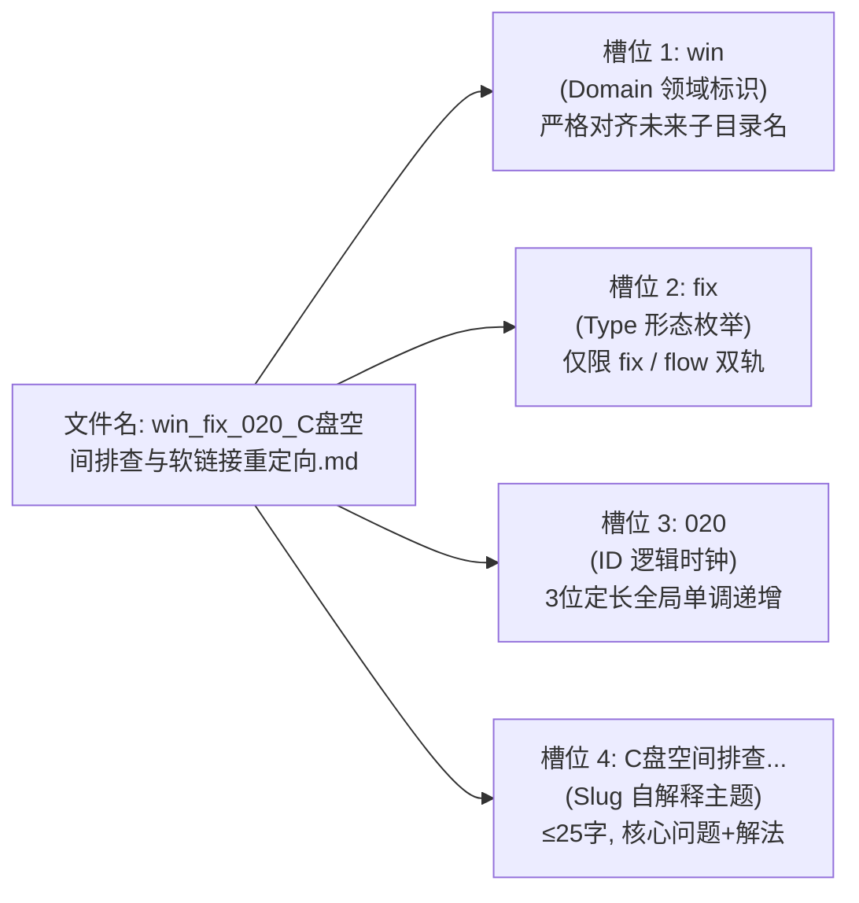
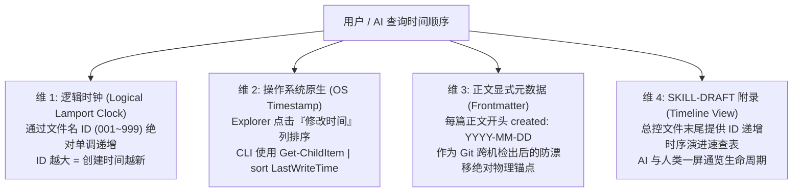

# 50-Windows平铺知识库文件名元数据嵌入架构与双端自解释命名规范

> **条目定位**：Type B 方案与流水线型条目  
> **适用场景**：单目录平铺（零子目录）知识库在文章规模达到 50~100+ 篇时，解决 Windows 资源管理器排序割裂、长标题截断、机器无法正则提取分类标签等元数据缺失问题，同时解耦领域聚块与时序追踪认知冲突。

---

## 一、业务场景与元数据痛点

在坚持**“单目录完全平铺（Flat Structure，无子目录嵌套）”**的知识库架构下，随着条目从数十篇生长至 70+ 篇乃至数百篇，原有 `0N-目标技术核心问题与解决目标.md` 的单一流水号命名法暴露出一系列工程缺陷：

1. **同类领域割裂（排序失控）**：
   - 依赖纯数字序号（`01~72`）前缀，导致在 Windows 资源管理器（按名称排序）中，相同主题的条目被强行拆散。例如 Git 相关手记散落在 `01`、`02`、`03`、`06`、`27`、`31`、`58`；Sublime 相关手记散落在 `01`、`16`、`33`、`34`、`44`、`47`。
   - 人类浏览时必须逐行通读冗长汉字，缺乏领域聚合块（Visual Chunks）。
2. **条目属性隐匿（形态缺失与契约漂移）**：
   - 无法直接通过文件名判断条目属于 **Type A（疑难报错排障）** 还是 **Type B（端到端实现流水线）**。
   - 若引入 `cfg`、`guide` 等弱动作修饰词，类型边界模糊，AI 归类和决策熵急剧增加，偏离全域创作总规范（`sh-skill-authoring-rules` 卷三）明确的 Type A/B 双轨制。
3. **时序与聚类认知对立（时间流被领域打散）**：
   - 当文件名采用领域前缀（如 `git_*`, `win_*`）以实现 Explorer 自动聚类时，全局创建时间顺序被彻底打散。
   - 人类与 AI 在追溯“最新创建了什么”、“历史演进脉络”或“排查最新手记”时，缺乏零成本的时间顺序感知通道。
4. **单目录容量逼近物理分层阈值**：
   - 知识库条目突破 70+ 篇，未来扩展到 150+ 篇时将面临物理分层诉求。必须在平铺设计之初将文件名设计为“序列化的虚拟路径”，确保未来分层迁移时 0 代码断裂、0 引用重构成本。
5. **机器消费高昂与视窗截断**：
   - 外部 Agent 或脚本无法零 I/O 成本提取元数据，必须全量读取正文 frontmatter；传统长标题动辄 40~50 字符，在分屏或详细信息模式下关键动作往往被尾部 `...` 截断。

---

## 二、底层设计难点与 Windows 文件系统约束

构建“人机双端自解释”的平铺文件名，必须在 Windows 物理文件系统约束与开发体验之间取得严格平衡：

### 1. Windows 文件名硬性红线
* **绝对保留字符禁止**：严禁出现 `\ / : * ? " < > |`。**这意味着不可使用冒号作为键值对分隔符（如 `type:fix` 在 Windows 上属于非法文件名）**。
* **大小写不敏感（Case-Preserving Case-Insensitive）**：Windows 底层 NTFS 默认忽略文件名大小写，因此不可通过 CamelCase 大小写切换来作为语义识别切分标记。
* **CLI 与 Shell 逃逸友好性**：若使用方括号 `[tag]`、括号 `(tag)` 或井号 `#tag`，在 PowerShell、Bash、Glob 通配符中均属于特殊控制符，命令行处理时极易发生转义错误；下划线 `_` 和连字符 `-` 对所有 Shell 均 100% 安全免转义。

### 2. 双重分隔符机制（Dual-Delimiter Pattern）
借鉴科学数据命名规范（如 BIDS / POSIX Portable Filenames）：
* **槽位分隔符（Field Delimiter）**：统一采用 **下划线 `_`**。专门负责切分不同维度的元数据字段；
* **语义内连接符（Word Delimiter）**：统一采用 **连字符 `-`** 或汉字短语。负责连接同一槽位内部的复合词。

### 3. Explorer 自然排序权重（Natural Sort Weight）
Windows 资源管理器按名称升序排序时，遵循 ASCII 字符字典序：`0-9` 优于 `a-z`。通过为槽位规定定长前缀，可彻底锁定 Explorer 中的可视聚类结构。

---

## 三、标准规范实现：极简双轨分面槽位语法（Faceted Kebab-Snake）

### 1. 语法结构定义
平铺知识库文件名由 4 个固定槽位组成，语法定义如下：

```text
<domain>_<type>_<id>_<slug>.md
```



* **正则表达式（无损提取校验）**：
  ```regex
  ^(?<domain>[a-z]{2,8})_(?<type>fix|flow)_(?<id>\d{3})_(?<slug>[^_\/\\:\*\?"<>\|]+)\.md$
  ```

---

### 2. 槽位 1：受控领域词典（Domain Vocabulary）
严格限制在纯小写英文字母，**1:1 对齐未来物理分层的子目录名**。在 Windows Explorer 中，同领域条目将自动整齐聚类在一起：

| 领域标识 | 含义与归属范围 | 现有条目归属示例 |
| :--- | :--- | :--- |
| **`win`** | Windows 系统底层、C盘空间、音频爆音、网络回环、计划任务、Everything、软链接、进程取证、输入法与任务栏 | `win_fix_011_计划任务控制台委托闪窗与conhost注册.md`<br>`win_fix_020_Win系统C盘空间不足排查与软链接重定向.md`<br>`win_fix_054_Win11任务栏输入指示图标隐藏与Windhawk代码注入.md` |
| **`git`** | 版本控制、Merge、Rebase、Worktree、SSH 多账号、GitLG、批量提交流水线 | `git_fix_002_变基PermissionDenied文件锁排障与安全恢复.md`<br>`git_flow_027_多Git账号SSH与IncludeIf配置.md`<br>`git_fix_058_Git批量提交高思考档分析瘫痪排障与灰色资产判决.md` |
| **`ide`** | 常用编辑器与终端（Sublime、Zed、Cursor、VSCode、Windows Terminal、Pi） | `ide_flow_004_Cursor预览独立标签页切换.md`<br>`ide_fix_022_Zed语言服务器重命名与杀毒竞态.md`<br>`ide_fix_048_WinTerminal分屏窗格判定与关闭误触.md` |
| **`agent`** | AI 客户端、OpenCode、CLI 管道防挂起、模型供应商配置、API Key 治理、ConnectRPC | `agent_fix_021_opencode连接GLM鉴权401与端点排障.md`<br>`agent_flow_045_全机AI密钥清点与供应商指纹脱敏.md`<br>`agent_fix_068_AGYManager切换失败target-conflict与汉化进程冲突.md` |
| **`browser`**| 浏览器底层、扩展注入机制、SNSS 会话恢复、DevTools MCP 联动 | `browser_fix_009_Chrome关闭标签丢失SNSS快照找回.md`<br>`browser_fix_049_Chrome与Firefox静默安装迅雷与BT替代.md` |
| **`dev`** | 跨语言环境配置、工程架构、构建流水线（Python-docx、uv、Java、Maven、OOP 重构、向量检索） | `dev_flow_015_docx自动化生成试卷与排版流水线.md`<br>`dev_flow_007_uv统一全机Python与新机引导复现.md`<br>`dev_flow_040_AI辅助面向对象OOP重构与模式演进.md` |
| **`media`** | 媒资处理、音频下载、声学降噪掩蔽、网盘解析与视频字幕 | `media_flow_013_降噪耳机人声泄露声学掩蔽与公有音频.md`<br>`media_flow_059_百度网盘在线秒播与Alist聚合挂载提速.md` |

---

### 3. 槽位 2：条目形态词典（极简双轨制收敛）
严格对齐 `sh-skill-authoring-rules` 卷三的规范体系，**彻底废除 `guide`、`cfg` 等无动作导向的弱词，形态绝对收敛为两种正交枚举**：

| 形态标识 | 对应全域规范 | 核心特征与四段论结构 | 历史弱词收敛规则 |
| :--- | :--- | :--- | :--- |
| **`fix`** | **Type A 疑难排障** | 错误报错直击、系统底层根因、原子化抢救 SOP、防复发闭环验证 | **偏排错排障归 `fix`**：所有报错抢救、锁冲突、进程挂起、退格失效、静默注入清理等条目一律归为 `fix`。 |
| **`flow`** | **Type B 方案/流水线** | 业务场景输入输出、核心技术剖析、完整可复用脚本框架、交付验收断言 | **偏全新自动化配置与生成归 `flow`**：原 `cfg`（如 PowerShell7部署、SSH配置）及 `guide`（如 OOP重构、试卷生成）统一归入端到端交付流水线 `flow`。 |

---

### 4. 槽位 3：三位定长序号与逻辑时钟（ID）
* 采用 `001` ~ `999` 格式（如 `001`、`050`、`072`）。
* **全局唯一 UID 与逻辑时钟**：`001` 到 `999` 单调递增，永不回收复用，与历史引用和外部映射严格兼容。**ID 大小 100% 等价于条目的创建时序**。

---

### 5. 槽位 4：人读自解释主题（Human Slug）
* **精炼原则**：删除无实义后缀（如“...指南.md”、“...实战.md”全部剔除），直接表达“**核心问题/技术词 + 解决核心/产生物**”；
* **长度控制**：中文控制在 25 字符以内，确保在 Windows 资源管理器详细信息列表模式下 100% 完整显示不换行、不被 `...` 截断。

---

## 四、四维时间顺序感知模型（Time-Order Perception Model）

针对“文件名领域前置后，Windows 资源管理器按字母排序打散时间流”的痛点，本规范建立**四维立体时序感知体系**，人类与 AI 均可零成本、全场景感知条目生命周期：



### 维 1：ID 即逻辑时钟（Logical Lamport Clock）
* `<id>` 严格按照时间先后创建分配，`072` 必定诞生于 `071` 之后。
* 无论文件名怎么按领域聚合，**ID 数值完全等价于时间先后**。
* 命令行秒级按时间排序（无需扫描正文）：
  ```powershell
  # 按 ID 逻辑时钟升序排序列出所有条目
  Get-ChildItem -Filter "*.md" | Where-Object { $_.Name -match '^\w+_(fix|flow)_(\d{3})_' } | Sort-Object { [int]($Matches[2]) }
  ```

### 维 2：Windows Explorer 视窗切换（零成本原生交互）
Windows 资源管理器本身天然具备多视图列头排序能力：
* **想看领域聚合**：点击 Explorer **“名称 (Name)”** 列头排序，同领域 `git_*`、`win_*` 聚合显现；
* **想看时间流 / 最近更新**：点击 Explorer **“修改日期 (Date modified)”** 列头排序，最新活跃手记跃然顶层。

### 维 3：正文 YAML Frontmatter 物理绝对时间锚点
在正文 YAML frontmatter 中显式固化物理创建与修订日期：
```yaml
---
name: kb-flat-filename-metadata-spec
created: 2026-10-10
updated: 2026-10-17
---
```
彻底克服 Git clone 或跨电脑检出导致本地文件系统 `LastWriteTime` 被批量刷新的物理缺陷，作为防漂移的唯一物理真实来源。

### 维 4：`SKILL-DRAFT.md` 时间线视图（Timeline View）
在总控文件 `SKILL-DRAFT.md` 的文末附录中，维护一份按 ID 单调递增的《条目时序演进检索表》，外部 Agent 载入该总控文件后，无需列举文件即可一屏通览最新落地的前 N 篇条目。

---

## 五、面向未来的子目录物理分层平滑演进与虚拟路径契约

平铺结构在 100 篇以内具有极高的检索敏捷性，但当条目规模达到 150+ 篇或单一领域突破 30 篇时，物理分层成为必然诉求。本架构在平铺阶段即完成虚拟路径契约绑定：

### 1. 序列化虚拟路径契约
```text
平铺虚拟路径: kb-engineering-notes/<domain>_<type>_<id>_<slug>.md
                         ▲
                         │ 双向 1:1 无损映射（仅替换首个下划线为斜杠）
                         ▼
分层物理路径: kb-engineering-notes/<domain>/<type>_<id>_<slug>.md
```
因为平铺文件名中的 `<domain>` 严格限制为 7 个受控子目录名，因此**平铺文件名本质上就是序列化的相对路径**。未来即使将文件移入对应子目录，文件名本体 `<type>_<id>_<slug>.md` 依然完全自解释且保留全局唯一 ID。

### 2. 平滑演进触发阈值
* **触发条件**：知识库条目总量 ≥ 150 篇，或任意单一领域条目 ≥ 30 篇。
* **无损切换**：配套工具 `scripts/organize_subdirs.ps1` 支持 `-ToSubdirs`（平铺下沉分层）与 `-ToFlat`（分层逆向上浮平铺）双向秒级切换。
* **引用不断裂**：迁移工具会自动对 `SKILL-DRAFT.md` 以及外部关联引用进行相对路径批量正则同步，Git blame 完整保留，重构成本趋近于零。

---

## 六、双端消费实证对比

### 1. 人类视角：Windows 文件资源管理器效果
在平铺目录下按“名称”排序，文件呈现出**天然的分块聚合目录感**：

```text
kb-engineering-notes/
├── SKILL-DRAFT.md
├── agent_fix_021_opencode连接GLM鉴权401与端点排障.md
├── agent_fix_042_多Agent全局规则生效与CLI管道防挂起.md
├── agent_fix_043_OpenCodeGo模型提速与关闭思考reasoningEffort.md
├── agent_fix_056_DSH挂载MCP包装层内存膨胀治理与直连改造.md
├── agent_fix_068_AGYManager切换失败target-conflict与汉化进程冲突.md
├── agent_fix_069_AGY桌面端会话覆写逆向与ConnectRPC热推送.md
├── agent_flow_012_CLI执行模式辨析与免批YOLO配置.md
├── agent_flow_029_cc-switch直接读写SQLite模型迁移.md
├── agent_flow_036_各Agent客户端终端机制与GitBash切换.md
├── agent_flow_038_Zed集成opencodeAgent思考档位与供应商迁移.md
├── agent_flow_039_无搜索API时DDG端点核查与一手信源收敛.md
├── agent_flow_045_全机AI密钥清点与供应商指纹脱敏.md
├── browser_fix_009_Chrome关闭标签丢失SNSS快照找回.md
├── browser_fix_049_Chrome与Firefox静默安装迅雷与BT替代.md
├── browser_flow_037_opencode集成chrome-devtools-mcp浏览器控制.md
├── dev_fix_051_离线Markdown向量检索混合漏检排障.md
├── dev_fix_071_WailsV3WebView2高内存治理与关窗生命周期重构.md
├── dev_flow_007_uv统一全机Python与新机引导复现.md
├── dev_flow_008_Win下Java与Maven便携配置及Zed集成.md
├── dev_flow_015_docx自动化生成试卷与排版流水线.md
├── dev_flow_040_AI辅助面向对象OOP重构与模式演进.md
├── dev_flow_067_本机Web应用自签cookie真机取证与浏览器进入.md
├── git_fix_001_SublimeMerge非相邻提交Squash合并重排.md
├── git_fix_002_变基PermissionDenied文件锁排障与安全恢复.md
├── git_fix_003_变基Rescheduled队列挂起与冲突解析.md
├── git_fix_058_Git批量提交高思考档分析瘫痪排障与灰色资产判决.md
├── git_flow_006_Worktree跨语言依赖复用与环境隔离权衡.md
├── git_flow_027_多Git账号SSH与IncludeIf配置.md
├── git_flow_031_VSCode底部面板GitLG配色调优.md
├── ide_fix_010_CLI粘贴图片Kitty透传与BOM排障.md
├── ide_fix_016_SublimeTerminus退格失效与原生终端集成.md
├── ide_fix_022_Zed语言服务器重命名与杀毒竞态.md
├── ide_fix_023_Zed与IDEA外接ACP代理失效与进程堆积.md
├── ide_fix_024_Zed面板InternalError会话中断与锁竞态.md
├── ide_fix_025_Zed会话丢失提取与SQLite解析抢救.md
├── ide_fix_028_Win终端Atuin历史同步与Profile修复.md
├── ide_fix_035_Pi终端改键与滚轮协议冲突修复.md
├── ide_fix_044_SublimeMarkdown预览抢焦点与静默改键.md
├── ide_fix_047_Sublime全局搜索穿透Gitignore慢查排障.md
├── ide_fix_048_WinTerminal分屏窗格判定与关闭误触.md
├── ide_fix_053_WinTerminal拆分窗格cd目录丢失与OSC99上报.md
├── ide_fix_060_Zed终端无会话恢复agy历史ID丢失与选号恢复.md
├── ide_fix_061_WinTerminal定制版PE图标损坏Defender误杀排障.md
├── ide_fix_066_同步publish重入前端覆盖层擦不掉与视图分叉.md
├── ide_fix_070_AnswerMeWithHTML架构与DarkReader暗黑冲突排障.md
├── ide_flow_004_Cursor预览独立标签页切换.md
├── ide_flow_005_Cursor免审批YOLO模式与沙箱网络.md
├── ide_flow_026_Zed项目级LSP白名单与内存优化.md
├── ide_flow_030_VSCode扩展跨分支IDE手动搬运.md
├── ide_flow_033_YaHeiConsolasHybrid字体渲染与Sublime配置.md
├── ide_flow_034_Win11右键菜单注册Sublime与注册表快捷管理.md
├── media_flow_013_降噪耳机人声泄露声学掩蔽与公有音频.md
├── media_flow_059_百度网盘在线秒播与Alist聚合挂载提速.md
├── win_fix_011_计划任务控制台委托闪窗与conhost注册.md
├── win_fix_017_Win声卡爆音无声与虚拟音频抢占排查.md
├── win_fix_018_Win代理下微软商店与UWP回环豁免.md
├── win_fix_019_Win内存防死机与Pagefile提交归因优化.md
├── win_fix_020_Win系统C盘空间不足排查与软链接重定向.md
├── win_fix_041_Win跨盘单文件软链接权限与Junction排障.md
├── win_fix_046_Win进程启动来源取证与Everything闲置保护.md
├── win_fix_052_PE控制台委托DefTerm断层与MCP无窗口镜像.md
├── win_fix_054_Win11任务栏输入指示图标隐藏与Windhawk代码注入.md
├── win_fix_055_划词工具CtrlC误杀终端与AltShift切语言排障.md
├── win_fix_064_Win单按Alt抢焦点与豆包输入法右Alt语音透传.md
├── win_fix_065_Win文件外部句柄持有原子替换失败写入静默丢失.md
├── win_fix_072_Win11高频AltTab卡键停留在切换界面与AHK钩子修复.md
├── win_flow_014_Win单手盲切与抽屉式Toggle窗口AHK配置.md
├── win_flow_032_Win便携PowerShell7绿色部署.md
├── win_flow_050_平铺知识库文件名元数据规范与迁移SOP.md
├── win_flow_057_常驻Pwsh替换为csc现场编译原生Win32与零conhost.md
├── win_flow_062_WinGUI自动化能力阶梯与UIA元素点击验证.md
└── win_flow_063_Win无窗口服务快捷方式与自重启及PS5.1排障.md
```

### 2. 机器视角：PowerShell 零成本秒级无损提取

```powershell
# 1. 极速提取元数据（无需解析任何正文，开销趋近于 0）
$file = "browser_fix_049_Chrome与Firefox静默安装迅雷与BT替代.md"
$domain, $type, $id, $title = $file.Split('_', 4)

# 机器获取的对象结构：
[PSCustomObject]@{
    Domain = $domain  # "browser"
    Type   = $type    # "fix"
    ID     = $id      # "049"
    Title  = $title   # "Chrome与Firefox静默安装迅雷与BT替代.md"
}

# 2. Agent 命令行一键精准检索
# 仅筛选所有 Git 疑难排障手记：
Get-ChildItem -Filter "git_fix_*"

# 仅筛选所有自动化生成流水线：
Get-ChildItem -Filter "*_flow_*"
```

---

## 七、全库 01~72 篇批量平滑迁移与安全回滚 SOP

为了在不破坏知识库正常运行的前提下完成历史文档的升级，提供带 **试跑（DryRun）** 与 **一键回滚（Rollback）** 的安全迁移脚本参考实现，规则表覆盖全库 **01~72** 篇条目映射。

### 自动化迁移脚本参考实现（按需创建临时脚本执行）

> 💡 **设计说明**：迁移脚本作为随需即用（On-demand）的 SOP 代码块归档于本规范中。如未来需执行物理批量迁移，只需在知识库根目录下临时创建 `migrate_kb_filenames.ps1` 执行，跑完并验证映射后即可随时删除。

```powershell
param(
    [switch]$Execute,   # 显式指定才执行物理改名，默认仅预览 (DryRun)
    [switch]$Rollback   # 一键从 mapping.json 恢复原始文件名
)

$kbDir = Split-Path $PSScriptRoot -Parent
$mapFile = Join-Path $PSScriptRoot "rename_mapping.json"
$draftFile = Join-Path $kbDir "SKILL-DRAFT.md"

if ($Rollback) {
    if (-not (Test-Path $mapFile)) {
        Write-Error "未找到回滚映射表 $mapFile"
        exit 1
    }
    $map = Get-Content $mapFile -Raw -Encoding UTF8 | ConvertFrom-Json
    $draftContent = if (Test-Path $draftFile) { [System.IO.File]::ReadAllText($draftFile, [System.Text.Encoding]::UTF8) } else { $null }

    foreach ($item in $map) {
        $oldPath = Join-Path $kbDir $item.NewName
        $origPath = Join-Path $kbDir $item.OldName
        if (Test-Path $oldPath) {
            Rename-Item -Path $oldPath -NewName $item.OldName -Force
            Write-Host "已恢复: $($item.NewName) -> $($item.OldName)" -ForegroundColor Yellow
        }
        if ($draftContent) {
            $draftContent = $draftContent.Replace($item.NewName, $item.OldName)
        }
    }
    if ($draftContent) {
        [System.IO.File]::WriteAllText($draftFile, $draftContent, [System.Text.Encoding]::UTF8)
        Write-Host "SKILL-DRAFT.md 链接已同步回滚。" -ForegroundColor Yellow
    }
    exit 0
}

# 全库 01~72 篇极简双轨规则字典（fix / flow）
$ruleMap = @{
    "01" = @{ Dom = "git";     Type = "fix";  Title = "SublimeMerge非相邻提交Squash合并重排.md" }
    "02" = @{ Dom = "git";     Type = "fix";  Title = "变基PermissionDenied文件锁排障与安全恢复.md" }
    "03" = @{ Dom = "git";     Type = "fix";  Title = "变基Rescheduled队列挂起与冲突解析.md" }
    "04" = @{ Dom = "ide";     Type = "flow"; Title = "Cursor预览独立标签页切换.md" }
    "05" = @{ Dom = "ide";     Type = "flow"; Title = "Cursor免审批YOLO模式与沙箱网络.md" }
    "06" = @{ Dom = "git";     Type = "flow"; Title = "Worktree跨语言依赖复用与环境隔离权衡.md" }
    "07" = @{ Dom = "dev";     Type = "flow"; Title = "uv统一全机Python与新机引导复现.md" }
    "08" = @{ Dom = "dev";     Type = "flow"; Title = "Win下Java与Maven便携配置及Zed集成.md" }
    "09" = @{ Dom = "browser"; Type = "fix";  Title = "Chrome关闭标签丢失SNSS快照找回.md" }
    "10" = @{ Dom = "ide";     Type = "fix";  Title = "CLI粘贴图片Kitty透传与BOM排障.md" }
    "11" = @{ Dom = "win";     Type = "fix";  Title = "计划任务控制台委托闪窗与conhost注册.md" }
    "12" = @{ Dom = "agent";   Type = "flow"; Title = "CLI执行模式辨析与免批YOLO配置.md" }
    "13" = @{ Dom = "media";   Type = "flow"; Title = "降噪耳机人声泄露声学掩蔽与公有音频.md" }
    "14" = @{ Dom = "win";     Type = "flow"; Title = "Win单手盲切与抽屉式Toggle窗口AHK配置.md" }
    "15" = @{ Dom = "dev";     Type = "flow"; Title = "docx自动化生成试卷与排版流水线.md" }
    "16" = @{ Dom = "ide";     Type = "fix";  Title = "SublimeTerminus退格失效与原生终端集成.md" }
    "17" = @{ Dom = "win";     Type = "fix";  Title = "Win声卡爆音无声与虚拟音频抢占排查.md" }
    "18" = @{ Dom = "win";     Type = "fix";  Title = "Win代理下微软商店与UWP回环豁免.md" }
    "19" = @{ Dom = "win";     Type = "fix";  Title = "Win内存防死机与Pagefile提交归因优化.md" }
    "20" = @{ Dom = "win";     Type = "fix";  Title = "Win系统C盘空间不足排查与软链接重定向.md" }
    "21" = @{ Dom = "agent";   Type = "fix";  Title = "opencode连接GLM鉴权401与端点排障.md" }
    "22" = @{ Dom = "ide";     Type = "fix";  Title = "Zed语言服务器重命名与杀毒竞态.md" }
    "23" = @{ Dom = "ide";     Type = "fix";  Title = "Zed与IDEA外接ACP代理失效与进程堆积.md" }
    "24" = @{ Dom = "ide";     Type = "fix";  Title = "Zed面板InternalError会话中断与锁竞态.md" }
    "25" = @{ Dom = "ide";     Type = "fix";  Title = "Zed会话丢失提取与SQLite解析抢救.md" }
    "26" = @{ Dom = "ide";     Type = "flow"; Title = "Zed项目级LSP白名单与内存优化.md" }
    "27" = @{ Dom = "git";     Type = "flow"; Title = "多Git账号SSH与IncludeIf配置.md" }
    "28" = @{ Dom = "ide";     Type = "fix";  Title = "Win终端Atuin历史同步与Profile修复.md" }
    "29" = @{ Dom = "agent";   Type = "flow"; Title = "cc-switch直接读写SQLite模型迁移.md" }
    "30" = @{ Dom = "ide";     Type = "flow"; Title = "VSCode扩展跨分支IDE手动搬运.md" }
    "31" = @{ Dom = "git";     Type = "flow"; Title = "VSCode底部面板GitLG配色调优.md" }
    "32" = @{ Dom = "win";     Type = "flow"; Title = "Win便携PowerShell7绿色部署.md" }
    "33" = @{ Dom = "ide";     Type = "flow"; Title = "YaHeiConsolasHybrid字体渲染与Sublime配置.md" }
    "34" = @{ Dom = "ide";     Type = "flow"; Title = "Win11右键菜单注册Sublime与注册表快捷管理.md" }
    "35" = @{ Dom = "ide";     Type = "fix";  Title = "Pi终端改键与滚轮协议冲突修复.md" }
    "36" = @{ Dom = "agent";   Type = "flow"; Title = "各Agent客户端终端机制与GitBash切换.md" }
    "37" = @{ Dom = "browser"; Type = "flow"; Title = "opencode集成chrome-devtools-mcp浏览器控制.md" }
    "38" = @{ Dom = "agent";   Type = "flow"; Title = "Zed集成opencodeAgent思考档位与供应商迁移.md" }
    "39" = @{ Dom = "agent";   Type = "flow"; Title = "无搜索API时DDG端点核查与一手信源收敛.md" }
    "40" = @{ Dom = "dev";     Type = "flow"; Title = "AI辅助面向对象OOP重构与模式演进.md" }
    "41" = @{ Dom = "win";     Type = "fix";  Title = "Win跨盘单文件软链接权限与Junction排障.md" }
    "42" = @{ Dom = "agent";   Type = "fix";  Title = "多Agent全局规则生效与CLI管道防挂起.md" }
    "43" = @{ Dom = "agent";   Type = "fix";  Title = "OpenCodeGo模型提速与关闭思考reasoningEffort.md" }
    "44" = @{ Dom = "ide";     Type = "fix";  Title = "SublimeMarkdown预览抢焦点与静默改键.md" }
    "45" = @{ Dom = "agent";   Type = "flow"; Title = "全机AI密钥清点与供应商指纹脱敏.md" }
    "46" = @{ Dom = "win";     Type = "fix";  Title = "Win进程启动来源取证与Everything闲置保护.md" }
    "47" = @{ Dom = "ide";     Type = "fix";  Title = "Sublime全局搜索穿透Gitignore慢查排障.md" }
    "48" = @{ Dom = "ide";     Type = "fix";  Title = "WinTerminal分屏窗格判定与关闭误触.md" }
    "49" = @{ Dom = "browser"; Type = "fix";  Title = "Chrome与Firefox静默安装迅雷与BT替代.md" }
    "50" = @{ Dom = "win";     Type = "flow"; Title = "平铺知识库文件名元数据规范与迁移SOP.md" }
    "51" = @{ Dom = "dev";     Type = "fix";  Title = "离线Markdown向量检索混合漏检排障.md" }
    "52" = @{ Dom = "win";     Type = "fix";  Title = "PE控制台委托DefTerm断层与MCP无窗口镜像.md" }
    "53" = @{ Dom = "ide";     Type = "fix";  Title = "WinTerminal拆分窗格cd目录丢失与OSC99上报.md" }
    "54" = @{ Dom = "win";     Type = "fix";  Title = "Win11任务栏输入指示图标隐藏与Windhawk代码注入.md" }
    "55" = @{ Dom = "win";     Type = "fix";  Title = "划词工具CtrlC误杀终端与AltShift切语言排障.md" }
    "56" = @{ Dom = "agent";   Type = "fix";  Title = "DSH挂载MCP包装层内存膨胀治理与直连改造.md" }
    "57" = @{ Dom = "win";     Type = "flow"; Title = "常驻Pwsh替换为csc现场编译原生Win32与零conhost.md" }
    "58" = @{ Dom = "git";     Type = "fix";  Title = "Git批量提交高思考档分析瘫痪排障与灰色资产判决.md" }
    "59" = @{ Dom = "media";   Type = "flow"; Title = "百度网盘在线秒播与Alist聚合挂载提速.md" }
    "60" = @{ Dom = "ide";     Type = "fix";  Title = "Zed终端无会话恢复agy历史ID丢失与选号恢复.md" }
    "61" = @{ Dom = "ide";     Type = "fix";  Title = "WinTerminal定制版PE图标损坏Defender误杀排障.md" }
    "62" = @{ Dom = "win";     Type = "flow"; Title = "WinGUI自动化能力阶梯与UIA元素点击验证.md" }
    "63" = @{ Dom = "win";     Type = "flow"; Title = "Win无窗口服务快捷方式与自重启及PS5.1排障.md" }
    "64" = @{ Dom = "win";     Type = "fix";  Title = "Win单按Alt抢焦点与豆包输入法右Alt语音透传.md" }
    "65" = @{ Dom = "win";     Type = "fix";  Title = "Win文件外部句柄持有原子替换失败写入静默丢失.md" }
    "66" = @{ Dom = "ide";     Type = "fix";  Title = "同步publish重入前端覆盖层擦不掉与视图分叉.md" }
    "67" = @{ Dom = "dev";     Type = "flow"; Title = "本机Web应用自签cookie真机取证与浏览器进入.md" }
    "68" = @{ Dom = "agent";   Type = "fix";  Title = "AGYManager切换失败target-conflict与汉化进程冲突.md" }
    "69" = @{ Dom = "agent";   Type = "fix";  Title = "AGY桌面端会话覆写逆向与ConnectRPC热推送.md" }
    "70" = @{ Dom = "ide";     Type = "fix";  Title = "AnswerMeWithHTML架构与DarkReader暗黑冲突排障.md" }
    "71" = @{ Dom = "dev";     Type = "fix";  Title = "WailsV3WebView2高内存治理与关窗生命周期重构.md" }
    "72" = @{ Dom = "win";     Type = "fix";  Title = "Win11高频AltTab卡键停留在切换界面与AHK钩子修复.md" }
}

$plan = [System.Collections.Generic.List[PSCustomObject]]::new()
$files = Get-ChildItem -Path $kbDir -Filter "*.md" | Where-Object { $_.Name -match "^\d{2}-" }

foreach ($f in $files) {
    $num = $f.Name.Substring(0, 2)
    if ($ruleMap.ContainsKey($num)) {
        $meta = $ruleMap[$num]
        $padNum = $num.PadLeft(3, '0')
        $newName = "$($meta.Dom)_$($meta.Type)_$padNum`_$($meta.Title)"
        $plan.Add([PSCustomObject]@{
            OldName = $f.Name
            NewName = $newName
            OldPath = $f.FullName
            NewPath = (Join-Path $kbDir $newName)
        })
    }
}

if (-not $Execute) {
    Write-Host "=== 试跑模式 (DryRun) - 共计划转换 $($plan.Count) 个文件 ===" -ForegroundColor Cyan
    $plan | Format-Table -Property OldName, NewName -AutoSize
    Write-Host "提示：如需物理执行迁移，请运行: .\migrate_kb_filenames.ps1 -Execute" -ForegroundColor Yellow
} else {
    $plan | ConvertTo-Json -Depth 3 | Set-Content -Path $mapFile -Encoding UTF8
    $draftContent = if (Test-Path $draftFile) { [System.IO.File]::ReadAllText($draftFile, [System.Text.Encoding]::UTF8) } else { $null }

    foreach ($p in $plan) {
        Rename-Item -Path $p.OldPath -NewName $p.NewName -Force
        Write-Host "已重命名: $($p.OldName) -> $($p.NewName)" -ForegroundColor Green
        if ($draftContent) {
            $draftContent = $draftContent.Replace($p.OldName, $p.NewName)
        }
    }
    if ($draftContent) {
        [System.IO.File]::WriteAllText($draftFile, $draftContent, [System.Text.Encoding]::UTF8)
        Write-Host "SKILL-DRAFT.md 链接已全量同步替换。" -ForegroundColor Green
    }
    Write-Host "全量迁移完毕，映射已保存至 $mapFile" -ForegroundColor Green
}
```

---

## 八、交付验证与扩展建议

1. **零破坏渐进式推进**：
   * 本规范已直接固化落盘为知识库第 50 项，无需立即执行物理重命名，随时可作为团队或个人知识治理的标准规范查阅；
   * 后续新增条目（如 73 项起）可选择直接采用新语法 `<domain>_<type>_<id>_<slug>.md`，或在准备就绪时运行附带的迁移脚本一键完成 01~72 项全量规整。
2. **`SKILL-DRAFT.md` 同步保障**：
   * 迁移脚本在执行重命名时，会联动对 `SKILL-DRAFT.md` 内部的所有超链接路径执行全局精准替换，确保内部两级感知路由体系完全不中断。
