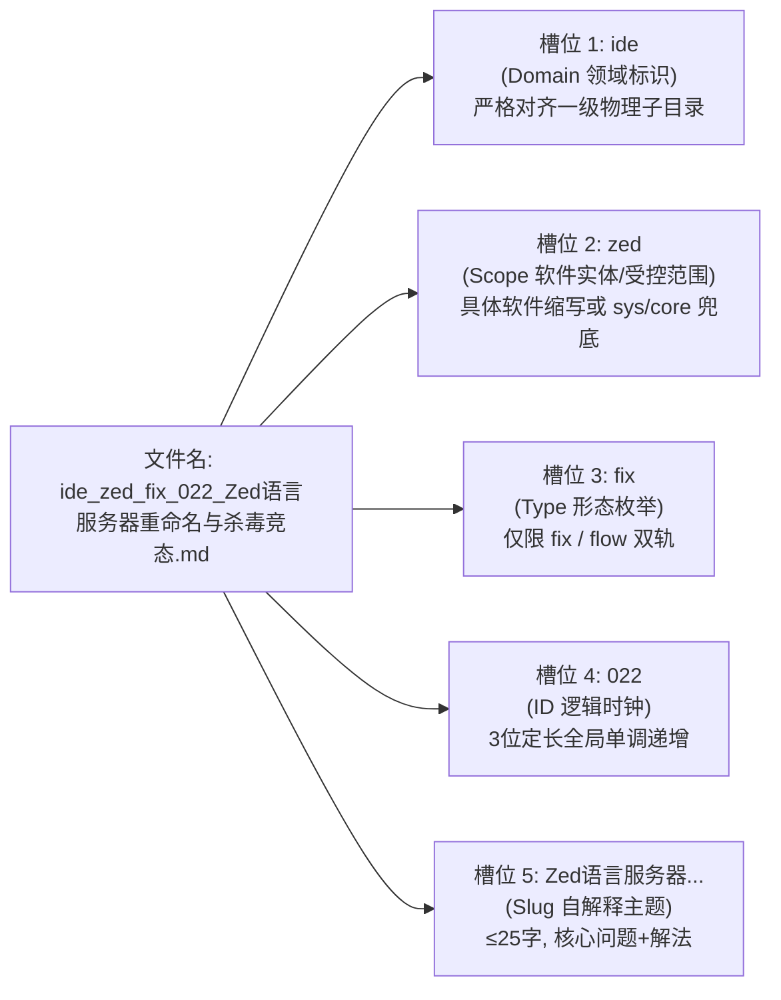
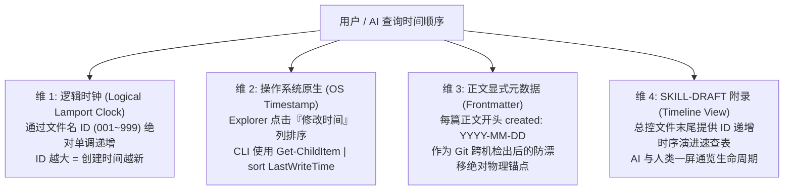

# 50-Windows平铺知识库文件名元数据嵌入架构与双端自解释命名规范

> **条目定位**：Type B 方案与流水线型条目  
> **适用场景**：单目录平铺（零子目录）知识库在文章规模达到 50~100+ 篇时，解决 Windows 资源管理器排序割裂、长标题截断、机器无法正则提取分类标签等元数据缺失问题，同时解耦软件实体聚类、领域分块与时序追踪认知冲突。

---

## 一、业务场景与元数据痛点

在坚持**“单目录完全平铺（Flat Structure，无子目录嵌套）”**的知识库架构下，随着条目从数十篇生长至 70+ 篇乃至数百篇，原有的单一流水号命名或仅带宏观领域前缀的命名法暴露出深层工程缺陷：

1. **同款软件/技术实体割裂（局部聚类失控）**：
   - 宏观领域（`ide`、`win`）颗粒度太粗。同属 `ide` 下，Zed 的手记散落在各处，与 Sublime、Cursor、Terminal 混杂交错；同属 `git` 下，变基（rebase）、多账号（ssh）、工作树（worktree）被强行打散。
   - 人类与 Agent 寻找某款软件的手记时，必须通读冗长汉字，缺乏软件实体的自然局部聚合块（Visual Chunks）。
2. **条目属性隐匿（形态缺失与契约漂移）**：
   - 无法直接通过文件名判断条目属于 **Type A（疑难报错排障）** 还是 **Type B（端到端实现流水线）**。
   - 若引入 `cfg`、`guide` 等弱动作修饰词，类型边界模糊，AI 归类和决策熵急剧增加，偏离全域创作总规范（`sh-skill-authoring-rules` 卷三）明确的 Type A/B 双轨制。
3. **时序与聚类认知对立（时间流被领域打散）**：
   - 当文件名采用领域与软件前缀以实现 Explorer 自动聚类时，全局创建时间顺序被彻底打散。
   - 人类与 AI 在追溯“最新创建了什么”、“历史演进脉络”或“排查最新手记”时，缺乏零成本的时间顺序感知通道。
4. **单目录容量逼近物理分层阈值**：
   - 知识库条目突破 70+ 篇，未来扩展到 150+ 篇时将面临物理分层诉求。必须在平铺设计之初将文件名设计为“序列化的虚拟路径”，确保未来分层迁移时 0 代码断裂、0 引用重构成本。
5. **机器消费高昂与视窗截断**：
   - 外部 Agent 或脚本无法零 I/O 成本提取元数据，必须全量读取正文 frontmatter；传统长标题动辄 40~50 字符，在分屏或详细信息模式下关键动作往往被尾部 `...` 截断。

---

## 二、底层设计难点与 Windows 文件系统约束

构建“人机双端自解释”的平铺文件名，必须在 Windows 物理文件系统约束与开发体验之间取得严格平衡：

### 1. Windows 文件名硬性红线
* **绝对保留字符禁止**：严禁出现 `\ / : * ? " < > |`。**这意味着不可使用冒号作为键值对分隔符（如 `type:fix` 在 Windows 上属于非法文件名）**。
* **大小写不敏感（Case-Preserving Case-Insensitive）**：Windows 底层 NTFS 默认忽略文件名大小写，因此不可通过 CamelCase 大小写切换来作为语义识别切分标记。
* **CLI 与 Shell 逃逸友好性**：若使用方括号 `[tag]`、括号 `(tag)` 或井号 `#tag`，在 PowerShell、Bash、Glob 通配符中均属于特殊控制符，命令行处理时极易发生转义错误；下划线 `_` 和连字符 `-` 对所有 Shell 均 100% 安全免转义。

### 2. 双重分隔符机制（Dual-Delimiter Pattern）
借鉴科学数据命名规范（如 BIDS / POSIX Portable Filenames）：
* **槽位分隔符（Field Delimiter）**：统一采用 **下划线 `_`**。专门负责切分不同维度的元数据字段；
* **语义内连接符（Word Delimiter）**：统一采用 **连字符 `-`** 或汉字短语。负责连接同一槽位内部的复合词。

### 3. Explorer 自然排序权重（Natural Sort Weight）
Windows 资源管理器按名称升序排序时，遵循 ASCII 字符字典序：`0-9` 优于 `a-z`。通过为槽位规定定长前缀，可彻底锁定 Explorer 中的可视聚类结构。

---

## 三、标准规范实现：五段式分面槽位语法（Faceted Kebab-Snake）

### 1. 语法结构定义
平铺知识库文件名严格由 5 个定长槽位组成，语法定义如下：

```text
<domain>_<scope>_<type>_<id>_<slug>.md
```



* **正则表达式（无损提取校验）**：
  ```regex
  ^(?<domain>[a-z]{2,8})_(?<scope>[a-z0-9]{2,8})_(?<type>fix|flow)_(?<id>\d{3})_(?<slug>[^_\/\\:\*\?"<>\|]+)\.md$
  ```

---

### 2. 槽位 1：受控领域词典（Domain Vocabulary）
严格限制在纯小写英文字母，**1:1 对齐未来物理分层的一级子目录名**。在 Windows Explorer 中，同领域条目将自动整齐聚类在一起：

| 领域标识 | 含义与归属范围 | 现有条目示例 |
| :--- | :--- | :--- |
| **`win`** | Windows 系统底层、C盘空间、音频爆音、网络回环、计划任务、Everything、软链接、进程取证、输入法与任务栏 | `win_conhost_fix_011_...`<br>`win_fs_fix_020_...`<br>`win_windhawk_fix_054_...` |
| **`git`** | 版本控制、Merge、Rebase、Worktree、SSH 多账号、GitLG、批量提交流水线 | `git_smerge_fix_001_...`<br>`git_rebase_fix_002_...`<br>`git_ssh_flow_027_...` |
| **`ide`** | 常用编辑器与终端（Sublime、Zed、Cursor、VSCode、Windows Terminal、Pi） | `ide_cursor_flow_004_...`<br>`ide_zed_fix_022_...`<br>`ide_terminal_fix_048_...` |
| **`agent`** | AI 客户端、OpenCode、CLI 管道防挂起、模型供应商配置、API Key 治理、ConnectRPC | `agent_opencode_fix_021_...`<br>`agent_core_flow_045_...`<br>`agent_agyman_fix_068_...` |
| **`browser`**| 浏览器底层、扩展注入机制、SNSS 会话恢复、DevTools MCP 联动 | `browser_chrome_fix_009_...`<br>`browser_devtools_flow_037_...` |
| **`dev`** | 跨语言环境配置、工程架构、构建流水线（Python-docx、uv、Java、Maven、OOP 重构、向量检索、CLI daemon） | `dev_uv_flow_007_...`<br>`dev_docx_flow_015_...`<br>`dev_cli_flow_073_...` |
| **`media`** | 媒资处理、音频下载、声学降噪掩蔽、网盘解析与视频字幕 | `media_audio_flow_013_...`<br>`media_alist_flow_059_...` |

---

### 3. 槽位 2：受控软件与技术实体词典（Scope Vocabulary）
解决同一领域下多款软件混杂的问题，使同款软件在文件列表中自然相邻聚类。**严禁留空，无特定独立软件实体的采用受控兜底词**：

#### A. 受控兜底字典（Fallback Scopes）
* **`sys`**：Windows 系统通用功能/底层机制（如任务栏、计划任务、系统快捷键、Windows 自带服务）。
* **`core`**：跨工具的基础模式、架构设计模式、开发哲学、离线检索算法。
* **`fs`**：文件系统底层、跨盘单文件软链接（Junction）、句柄排查、C 盘清理。
* **`cli`**：通用命令行/守护进程模式、管道输入、临时 daemon 模式。

#### B. 常见受控软件实体词汇表
- 编辑器与终端：`zed`、`cursor`、`vscode`、`sublime`、`smerge`、`terminal`、`terminus`、`atuin`、`pi`
- 系统增强与排障：`ahk`、`windhawk`、`everything`、`conhost`、`ps`、`uwp`、`mem`、`audio`
- 开发框架与工具：`uv`、`docx`、`wails`、`web`、`java`
- Git 专项：`rebase`、`worktree`、`ssh`
- 浏览器相关：`chrome`、`firefox`、`devtools`
- Agent 生态：`opencode`、`agy`、`agyman`、`dsh`、`ccswitch`、`yolo`
- 媒资存储：`alist`、`netdisk`

---

### 4. 槽位 3：条目形态词典（极简双轨制收敛）
严格对齐 `sh-skill-authoring-rules` 卷三的规范体系，**形态绝对收敛为两种正交枚举**：

| 形态标识 | 对应全域规范 | 核心特征与四段论结构 | 历史弱词收敛规则 |
| :--- | :--- | :--- | :--- |
| **`fix`** | **Type A 疑难排障** | 错误报错直击、系统底层根因、原子化抢救 SOP、防复发闭环验证 | **偏排错排障归 `fix`**：所有报错抢救、锁冲突、进程挂起、退格失效、静默注入清理等条目一律归为 `fix`。 |
| **`flow`** | **Type B 方案/流水线** | 业务场景输入输出、核心技术剖析、完整可复用脚本框架、交付验收断言 | **偏全新自动化配置与生成归 `flow`**：原 `cfg`（如 PowerShell7部署、SSH配置）及 `guide`（如 OOP重构、试卷生成）统一归入端到端交付流水线 `flow`。 |

---

### 5. 槽位 4：三位定长序号与逻辑时钟（ID）
* 采用 `001` ~ `999` 格式（如 `001`、`050`、`073`）。
* **全局唯一 UID 与逻辑时钟**：`001` 到 `999` 单调递增，永不回收复用，与历史引用和外部映射严格兼容。**ID 大小 100% 等价于条目的创建时序**。

---

### 6. 槽位 5：人读自解释主题（Human Slug）
* **精炼原则**：删除无实义后缀（如“...指南.md”、“...实战.md”全部剔除），直接表达“**核心问题/技术词 + 解决核心/产生物**”；
* **长度控制**：中文控制在 25 字符以内，确保在 Windows 资源管理器详细信息列表模式下 100% 完整显示不换行、不被 `...` 截断。

---

## 四、四维时间顺序感知模型（Time-Order Perception Model）

针对“文件名领域与实体前置后，Windows 资源管理器按字母排序打散时间流”的痛点，本规范建立**四维立体时序感知体系**，人类与 AI 均可零成本、全场景感知条目生命周期：



### 维 1：ID 即逻辑时钟（Logical Lamport Clock）
* `<id>` 严格按照时间先后创建分配，`073` 必定诞生于 `072` 之后。
* 无论文件名怎么按领域或实体聚类，**ID 数值完全等价于时间先后**。
* 命令行秒级按时间排序（无需扫描正文）：
  ```powershell
  # 按 ID 逻辑时钟升序排列列出所有条目
  Get-ChildItem -Filter "*.md" | Where-Object { $_.Name -match '^\w+_\w+_(fix|flow)_(\d{3})_' } | Sort-Object { [int]($Matches[2]) }
  ```

### 维 2：Windows Explorer 视窗切换（零成本原生交互）
Windows 资源管理器本身天然具备多视图列头排序能力：
* **想看领域与软件聚类**：点击 Explorer **“名称 (Name)”** 列头排序，同领域、同软件条目自动紧密排列在一起；
* **想看时间流 / 最近更新**：点击 Explorer **“修改日期 (Date modified)”** 列头排序，最新活跃手记跃然顶层。

### 维 3：正文 YAML Frontmatter 物理绝对时间锚点
在正文 YAML frontmatter 中显式固化物理创建与修订日期：
```yaml
---
name: kb-flat-filename-metadata-spec
created: 2026-10-10
updated: 2026-10-17
---
```
彻底克服 Git clone 或跨电脑检出导致本地文件系统 `LastWriteTime` 被批量刷新的物理缺陷，作为防漂移的唯一物理真实来源。

### 维 4：`SKILL-DRAFT.md` 时间线视图（Timeline View）
在总控文件 `SKILL-DRAFT.md` 的文末附录中，维护一份按 ID 单调递增的《条目时序演进检索表》，外部 Agent 载入该总控文件后，无需列举文件即可一屏通览最新落地的条目。

---

## 五、面向未来的子目录物理分层平滑演进与虚拟路径契约

平铺结构在 100 篇以内具有极高的检索敏捷性，但当条目规模达到 150+ 篇或单一领域条目突破 30 篇时，物理分层成为必然诉求。本架构在平铺阶段即完成虚拟路径契约绑定：

### 1. 序列化虚拟路径契约
```text
平铺虚拟路径: kb-engineering-notes/<domain>_<scope>_<type>_<id>_<slug>.md
                         ▲
                         │ 双向 1:1 无损映射（首个下划线映射为目录）
                         ▼
分层物理路径: kb-engineering-notes/<domain>/<scope>_<type>_<id>_<slug>.md
```
因为平铺文件名中的 `<domain>` 严格限制为 7 个受控子目录名，因此**平铺文件名本质上就是序列化的相对路径**。未来即使将文件移入对应子目录，文件名本体 `<scope>_<type>_<id>_<slug>.md` 依然完全自解释且保留全局唯一 ID 和实体聚合特征。

### 2. 平滑演进触发阈值
* **触发条件**：知识库条目总量 $\ge 150$ 篇，或任意单一领域条目 $\ge 30$ 篇。
* **无损切换**：配套工具 `scripts/organize_subdirs.ps1` 支持 `-ToSubdirs`（平铺下沉分层）与 `-ToFlat`（分层逆向上浮平铺）双向秒级切换。
* **引用不断裂**：迁移工具会自动对 `SKILL-DRAFT.md` 以及外部关联引用进行相对路径批量正则同步，Git blame 完整保留，重构成本趋近于零。

---

## 六、配套自动化工具集

| 脚本路径 | 功能说明 | 核心参数 |
| :--- | :--- | :--- |
| [`scripts/kb_timeline.ps1`](file:///d:/Users/language_projects/.agents/skills/kb-engineering-notes/scripts/kb_timeline.ps1) | 秒级输出知识库条目时序视图 | `-Top N`（查看最新N篇）<br>`-Domain <win\|git\|...>`<br>`-Scope <zed\|cursor\|...>`<br>`-Descending`（倒序排列） |
| [`scripts/organize_subdirs.ps1`](file:///d:/Users/language_projects/.agents/skills/kb-engineering-notes/scripts/organize_subdirs.ps1) | 平铺与子目录物理分层双向切换 | `-ToSubdirs`（平铺下沉分层）<br>`-ToFlat`（逆向上浮平铺）<br>`-Execute`（物理执行）<br>`-DryRun`（试跑预览） |
