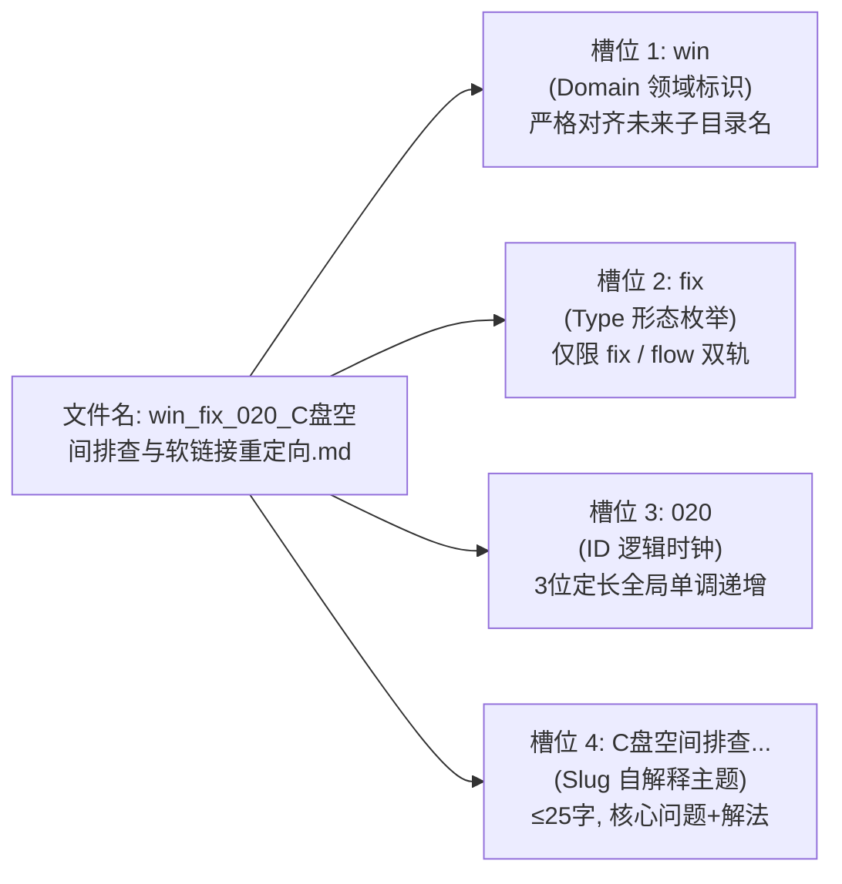
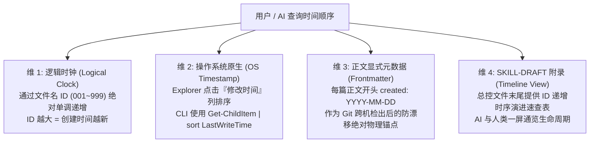

# Plan: Windows平铺知识库文件名元数据规范升级与时间序解耦演进设计

📋 Plan for: "针对 kb-engineering-notes 平铺知识库条目生长至 72+ 篇的现状，落实方案 A 极简双轨规范（fix/flow 收敛），集成时间顺序感知方案，置顶 SKILL-DRAFT.md 首屏契约，升级 50 号架构文档并预留零成本子目录物理分层迁移能力。"

## 问题陈述

1. **命名形态发散与契约漂移**：原 50 号文档定义了 `fix`、`flow`、`cfg`、`guide` 4 种类型，与全局创作规范（`sh-skill-authoring-rules` 卷三）明确规定的 Type A（疑难排障）和 Type B（方案/流水线）双轨制产生轻微漂移，类型越多边界越模糊，AI 归类和决策熵增。
2. **时间顺序认知诉求**：采用方案 A（领域前置：`<domain>_<type>_<id>_<slug>.md`）后，Windows 资源管理器按文件名升序排列时会按领域聚类（如 `git_*`, `win_*`），导致全局时序被打散。用户在追溯最近创建、历史演进脉络或排查最新手记时，缺乏低阻力的时间顺序视图。
3. **SKILL-DRAFT.md 缺乏首屏契约**：当前 `SKILL-DRAFT.md` 打开直接面对长篇文件树与表格，未在文件开头置顶元数据槽位定义与正则解析式，外部 Agent 无法在读取初期建立结构化索引认知。
4. **单目录容量逼近分层阈值**：知识库目前已积累 72 篇，未来扩展到数百篇时面临物理分层诉求。必须在现有命名中将 `<domain>` 设计为未来子目录的虚拟路径映射，确保未来分层迁移时 0 代码断裂、0 引用重构成本。

## 需求确认（含用户决策）

- **形态收敛（方案 A 极简双轨）**：形态严格收敛为 2 种正交枚举：`fix`（疑难排障 / Type A）与 `flow`（方案流水线 / Type B），彻底废除 `guide`、`cfg` 等无动作导向的弱词。用户原话决策：“*那就方案A吧*”。
- **时间顺序支持**：在领域前置保证 Explorer 聚块的同时，必须提供明确、轻量的时间顺序获取与审计机制，人类与 AI 均可秒级感知时序。用户原话诉求：“*但是如果我想知道时间顺序。该怎么做？*”。
- **首屏契约置顶**：`SKILL-DRAFT.md` 文件开头必须详细介绍命名槽位与元数据规范，便于 AI 和人类建立三重视角认知。
- **子目录分层前向兼容**：平铺命名本质为“序列化的虚拟路径”，未来若物理下沉至子目录，必须保持平滑无感、迁移成本趋近于零。
- **Kiro Plan 落盘**：结合当前 72 篇知识库实际内容重新做一次完整工程设计，并落盘至规范计划文件。

## 背景现状

- **库内条目规模**：`kb-engineering-notes` 现有编号条目已达 **72 篇**（`01-` 至 `72-`）。
- **50 号手记定位**：`50-Windows平铺知识库文件名元数据嵌入架构与双端自解释命名规范.md` 自身既是一篇 Type B 规范手记，也是全库批量迁移的母版工具。
- **总控文件状态**：`SKILL-DRAFT.md` 作为全库两级渐进式感知的第一级路由，承载全部 72 篇条目的场景映射。
- **既有迁移脚本**：`50 号手记` 内置了基础版 PowerShell 迁移脚本，但目前规则字典仅覆盖至 50 篇，且类型枚举仍为旧版 4 类。

## 方案架构

### 1. 语法架构：极简双轨分面槽位语法（Faceted Kebab-Snake）

```text
<domain>_<type>_<id>_<slug>.md
```



* **槽位 1 `<domain>`（受控领域，严格 7 枚举，与未来子目录 1:1 映射）**：
  `win`（Windows底层/系统/软链接/注册表）、`git`（版本控制/变基/Worktree/提交）、`ide`（编辑器/终端/Sublime/Zed/Cursor/WT）、`agent`（AI客户端/CLI/模型供应商/密钥）、`browser`（浏览器/扩展/ DevTools）、`dev`（语言/构建/uv/OOP/排版流水线）、`media`（音视频/下载/声学）。
* **槽位 2 `<type>`（极简双轨，绝对收敛）**：
  * **`fix`**：Type A 疑难排障（报错/死锁/竞态/抢占/崩溃，含原子 SOP 与底层根因）
  * **`flow`**：Type B 方案流水线（端到端构建/代码模版/环境一键引导/交付断言）
  * *原 `cfg` 收敛规则*：偏排错排障归 `fix`，偏全新自动化配置流水线归 `flow`。
* **槽位 3 `<id>`（逻辑时钟与唯一 UID）**：
  * `001` ~ `999`，定长 3 位，全局单调递增，永不回收复用。
* **槽位 4 `<slug>`（自解释人机双读短语）**：
  * `[核心问题/技术词] + [解决动作/交付物]`，剔除“指南”、“实战”等空洞后缀，中文 ≤25 字。

---

### 2. 时间顺序感知体系（四维时序解题模型）

针对领域前置导致 Explorer 按字母聚类打散时序的问题，建立四维立体时序解法：



1. **维 1：ID 即逻辑时钟（Logical Lamport Clock）**
   * `<id>` 严格按照时间先后创建分配，`072` 必定诞生于 `071` 之后。
   * 无论文件名怎么排，**ID 大小 100% 等价于条目时序**。
   * 命令行秒级按时间排序：
     ```powershell
     Get-ChildItem -Filter "*.md" | Sort-Object { [int]($_.Name.Split('_')[2]) }
     ```
2. **维 2：Windows Explorer 视窗切换（零成本原生交互）**
   * 想看**领域聚合**：点击 Explorer **“名称 (Name)”** 列排序；
   * 想看**时间流/最近更新**：点击 Explorer **“修改日期 (Date modified)”** 列排序。
3. **维 3：正文 YAML Frontmatter 绝对时间锚点**
   * 标准化注入 `created: YYYY-MM-DD` 与 `updated: YYYY-MM-DD`。
   * 解决 Git 克隆/跨电脑拉取导致文件系统 `LastWriteTime` 被刷新的物理缺陷。
4. **维 4：`SKILL-DRAFT.md` 时间线视图（Timeline View）**
   * 在主干场景表之后，附加一个紧凑的按 ID 单调递增的《条目演进时间表》，AI 可一键列出最新前 N 篇手记。

---

### 3. 子目录物理分层平滑演进预留

* **序列化契约**：`平铺文件名 <domain>_<type>_<id>_<slug>.md` ↔ `分层路径 <domain>/<type>_<id>_<slug>.md`
* **触发阈值**：当总条目达到 150+ 篇，或单一领域条目 ≥30 篇时触发。
* **迁移工具**：配套提供 `organize_subdirs.ps1`，支持 `-ToSubdirs`（物理分层）与 `-ToFlat`（逆向平铺）双向无损切换，自动同步更新 `SKILL-DRAFT.md` 的全部链接，Git blame 完整保留。

---

## 任务分解

- [x] Task 1: 升级 50 号架构手记正文规范
  - 文件：`D:\Users\language_projects\.agents\skills\kb-engineering-notes\50-Windows平铺知识库文件名元数据嵌入架构与双端自解释命名规范.md`
  - 实现：
    1. 将类型枚举从 4 种（fix/flow/cfg/guide）彻底收敛为 2 种（fix/flow 双轨制）；
    2. 新增专门章节阐明“四维时间顺序感知模型”；
    3. 增补“面向未来的子目录物理分层平滑演进与虚拟路径”架构说明；
    4. 扩充配套 PowerShell 迁移脚本，规则表覆盖全库 01~72 篇条目映射，并支持 DryRun 与 Rollback。
  - 验证：文件通过规范审计，正则表达式完全匹配，无语法冲突。
  - Demo：打开 50 号文档可清晰查阅极简双轨定义与时间序解决方案。

- [x] Task 2: 改造 `SKILL-DRAFT.md` 首屏契约与时间线索引
  - 文件：`D:\Users\language_projects\.agents\skills\kb-engineering-notes\SKILL-DRAFT.md`
  - 实现：
    1. 在文件首屏（YAML 下方）置顶嵌入 20 行《知识库文件命名规范与元数据契约（AI 与开发者速查）》；
    2. 明确标注槽位含义、严格受控词典与正则提取命令；
    3. 在文件末尾追加轻量级《条目时序演进检索表（按 ID 逻辑时钟升序）》，补全 51~72 篇新条目登记。
  - 验证：首屏包含完整契约代码块，末尾具备时序检索附录，内部相对链接 100% 连通。
  - Demo：外部 Agent 载入该文件后首屏即刻理解命名协议，无需阅读全量正文。

- [x] Task 3: 编写时序辅助与分层演进双向脚本
  - 文件：`D:\Users\language_projects\.agents\skills\kb-engineering-notes\scripts\kb_timeline.ps1`
  - 文件：`D:\Users\language_projects\.agents\skills\kb-engineering-notes\scripts\organize_subdirs.ps1`
  - 实现：
    1. `kb_timeline.ps1`：支持按 ID 逻辑时钟或创建日期秒级输出时序列表（支持 `-Top 10` 参数）；
    2. `organize_subdirs.ps1`：支持 `-ToSubdirs` 与 `-ToFlat`，带 `-DryRun`，实现平铺与子目录双向秒级转换及链接同步。
  - 验证：在终端执行 `-DryRun` 预览无报错，路径计算准确。
  - Demo：开发者运行 `./scripts/kb_timeline.ps1 -Top 5` 秒级获取最新 5 篇笔记。

- [x] Task 4: 联动更新 `sh-skill-authoring-rules` 卷三
  - 文件：`D:\Users\language_projects\.agents\skills\sh-skill-authoring-rules\SKILL.md`
  - 实现：在卷三中固化“平铺分面槽位命名规范（Faceted Kebab-Snake）”与“平铺虚拟路径契约”，锁定 fix/flow 双轨标准。
  - 验证：字数校验严格 ≤1024 字符（如果触碰 description），正文更新精准对齐。
  - Demo：查阅规范卷三可看到明确的槽位命名规则与分层前向兼容约定。

- [x] Task 5: 验证与交付汇报
  - 文件：全库检查
  - 实现：全流程无破坏验证，确保既有 72 篇条目完好无损，新规范与脚本全部就绪。
  - 验证：git status 确认变动仅限于计划声明的文件范围。
  - Demo：输出完成报告，汇报双轨收敛、时间序机制与计划文件落盘详情。

---
**实施说明**：本计划严格遵循 `sh-plan-driven-development` 交付计划模式，计划文件落盘后即作为权威执行蓝图。
