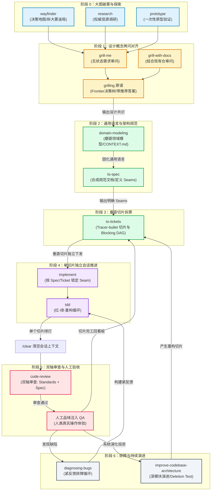

# sh-mattpocock-skills: Matt Pocock 软件工程全域技能族路由器

> **核心哲学：软件基本功没死，它在 AI 时代变得更值钱了。**  
> 好代码库让 AI 表现出色，坏代码库让 AI 一塌糊涂。本技能族是 Matt Pocock（`mattpocock/skills`，AI Hero 体系）工程哲学的落地路由器。  
> **明确反对 specs-to-code**（用规格书盲目生成代码、出问题改规格书而不改代码等同于放弃代码所有权的 vibe coding）；主张**“人做两件（规划与 QA），Agent 做一件（实现）”**，通过严格的**深模块设计、垂直切片曳光弹、测试接缝（Seams）、TDD 红绿循环与上下文清空回零**，筑牢 AI 时代的软件工程防线。

---

## 〇、纯血原则与排他性契约（Pure Matt Pocock Scope）

本路由器**严格且仅收录 Matt Pocock 原生推导的工程技能**，杜绝任何第三方混入：

| 领域环节 | Matt Pocock 官方纯正实现（收录） | 第三方 / 社区同类品（严格排除） | 排除理由与设计差异 |
| :--- | :--- | :--- | :--- |
| **代码审查** | `code-review` | `adversarial-reviewer`（ekreloff） | `code-review` 采用双轴独立并行 sub-agents（Standards 规范轴 + Spec 原始需求轴），严格对照预先确定的接缝与规范；非纯角色扮演。 |
| **架构演进** | `improve-codebase-architecture` | `architecture-patterns` / `clean-code` | 依托《软件设计哲学》深模块（Deep Modules）理论，通过 Git Hot-Spots 定位高摩擦点，运行 Deletion Test 并产出可视化 HTML 报告；非模板化大词堆砌。 |
| **需求审问** | `grill-me` / `grilling` / `grill-with-docs` | 提示词模板 / 开放式漫谈 | 状态机决策树模型，严格按 Frontier 推进，一次推一轮，**每题必须给出推荐答案**，逼到共识为止。 |
| **任务拆解** | `to-tickets` | 水平分层切分（数据库/API/UI） | 强制垂直切片（Tracer Bullets）与声明 `blocked by` 依赖图，保证单切片可在单次干净会话内交付。 |

---

## 一、生命周期流转图与技能关联拓扑（Workflow DAG）



---

## 二、14 个核心原子技能对照表（输入、输出与子模块路径）

| 技能名称 | 阶段与定位 | 输入源 (Inputs) | 核心产出 (Outputs) | 下游承接技能 (Next Step) | 子模块执行路径 |
| :--- | :--- | :--- | :--- | :--- | :--- |
| `wayfinder` | **0.大图破雾**：面对模糊庞大工程，绘制决策地图 | 模糊大想法、跨多个会话的庞大需求 | 决策工单图（Decision Tickets），每次只决断一件事 | `grill-me`（决断单项）或 `to-spec` | `sh-mattpocock-skills/wayfinder/SKILL.md` |
| `research` | **0.事实调研**：针对第一手权威信源深度调研 | 技术选型疑问、官方文档/API 取证 | 带权威信源引用的 Markdown 调查笔记 | `grill-me` / `to-spec` | `sh-mattpocock-skills/research/SKILL.md` |
| `prototype` | **0.原型验证**：一次性抛弃型原型（逻辑/UI） | 状态机手感不确定、UI 多风格选型 | 单文件 HTML / 动态分支，验证后抛弃不入库 | `domain-modeling` / `to-spec` | `sh-mattpocock-skills/prototype/SKILL.md` |
| `grill-me` | **1.需求审问**：无状态需求访谈入口 | 原始想法、一句话需求 | 扫清全部假设的设计概念共识 | `domain-modeling` / `to-spec` | `sh-mattpocock-skills/grill-me/SKILL.md` |
| `grilling` | **1.审问原语**：底层决策树驱动引擎 | Frontier 未决决策项 | 格式化问卷（带推荐答案）与收敛后的决策树 | 供 `grill-me` / `grill-with-docs` 调用 | `sh-mattpocock-skills/grilling/SKILL.md` |
| `grill-with-docs` | **1.仓内审问**：结合代码库现状与文档的深度拷问 | 现有代码仓、已存在的文档/规范 | 与工程上下文对齐的业务设计决策 | `domain-modeling` / `to-spec` | `sh-mattpocock-skills/grill-with-docs/SKILL.md` |
| `domain-modeling` | **2.领域建模**：提炼并磨砺通用语言（DDD） | 对齐后的设计概念、业务名词 | `CONTEXT.md`、`GLOSSARY.md`、架构决策记录 `ADR` | `to-spec` | `sh-mattpocock-skills/domain-modeling/SKILL.md` |
| `to-spec` | **3.规范合成**：无二次采访直接合成规范文档 | 前序审问共识、`CONTEXT.md` | 问题/解决方案/用户故事/实现决策/**测试接缝 Seams** | `to-tickets` | `sh-mattpocock-skills/to-spec/SKILL.md` |
| `to-tickets` | **3.切片拆票**：垂直切片（Tracer Bullets）与看板 | 规范文档 `to-spec` 产物 | 穿透各层的 Tickets 清单与 `blocked by` DAG 依赖 | `implement` | `sh-mattpocock-skills/to-tickets/SKILL.md` |
| `implement` | **4.切片落地**：按 ticket 实现并锁定 Seam | 单个 Ticket、预定 Seam | 最小实现代码、通过类型检查与单测 | `code-review`（须先 `/clear`） | `sh-mattpocock-skills/implement/SKILL.md` |
| `tdd` | **4.反馈循环**：测试驱动开发（红-绿-重构） | 预先确认的公共接缝 Seam | 失败测试（红） $\to$ 最小通过实现（绿） $\to$ 干净代码 | `implement` / `code-review` | `sh-mattpocock-skills/tdd/SKILL.md` |
| `code-review` | **5.双轴审查**：Standards 规范轴 + Spec 需求轴 | 变更 diff、起源 spec、Repo 规范 | 双轴独立审查报告（含 Fowler 代码坏味道诊断） | 人工 QA 验收 | `sh-mattpocock-skills/code-review/SKILL.md` |
| `diagnosing-bugs` | **6.排障循环**：疑难 Bug 与性能退化排障 | 报错堆栈、异常行为、重现线索 | 极窄可复现反馈闭环（Tight Loop）、根因诊断与修复 | `tdd` 固化防回归测试 | `sh-mattpocock-skills/diagnosing-bugs/SKILL.md` |
| `improve-codebase-architecture`| **6.架构演化**：扫描浅模块并推进深模块重构 | Git Commit 热点（Hot Spots）、代码库 | 深度机会 HTML 报告、Before/After 架构对比与重构方案 | `to-tickets` | `sh-mattpocock-skills/improve-codebase-architecture/SKILL.md` |

---

## 三、端到端关联协作协议（SOP）

当用户唤起 Matt Pocock 工作流时，AI 必须严格执行以下**六步流转协议**：

### 步骤 1：需求复杂度分诊与对齐（Phase 1）
- **判断标准**：
  - 一句话说得清、改动仅 1~2 个文件：**直接干，跳过繁琐流程**。
  - 说不清 / 跨多层 / 动核心数据模型 / 宏大构想：
    - 若整个方向处于迷雾中：调入 `wayfinder` 绘制决策地图；
    - 若已有明确功能构想：开新会话调入 `grill-me`（或 `grill-with-docs`），执行无情审问。
- **关联规则**：必须一次推一整轮 Frontier（未决问题集合），**每道题必须给出 AI 的推荐选项**；直到决策树完全收敛。

### 步骤 2：通用语言与领域模型固化（Phase 2）
- **动作**：审问完成后，绝不直接编码！调入 `domain-modeling`，将讨论中沉淀的核心名词与业务边界固化到 `CONTEXT.md` / `GLOSSARY.md` 与 ADR 中。
- **关联契约**：后续所有 Agent 指令必须以此文件为统一词汇来源，彻底根绝鸡同鸭讲。

### 步骤 3：高密度规范与接缝锁定（Phase 3）
- **动作**：调入 `to-spec`，基于步骤 1 的共识和步骤 2 的模型，直接合成规范。
- **关键铁律**：**严禁重新采访用户**；必须显式界定**测试接缝（Seams）**——确定在哪个公共接口处观察行为，绝不允许面向内部细节写测试。

### 步骤 4：垂直切片拆解与 DAG 依赖（Phase 4）
- **动作**：调入 `to-tickets`。
- **关键铁律（曳光弹原则）**：
  - 严禁按“数据库层 $\to$ 接口层 $\to$ 界面层”进行水平切片！
  - 每个 ticket 必须是**穿透全层的垂直切片（Tracer Bullet）**：改 schema + 加服务 + 简易界面，一次打通；
  - 每个切片标明 `blocked by`，切片大小以**单个独立上下文窗口（1 会话）能装下**为准。

### 步骤 5：单切片独立会话与 TDD 推进（Phase 5）
- **动作**：针对无阻塞的切片，启动独立会话调入 `implement`，调度 `tdd`。
- **关键铁律**：
  - 仅在约定的 Seams 处编写失败测试（红）；
  - 编写最小代码让测试变绿（绿）；
  - **完成一个切片，必须执行 `/clear` 清空上下文！**严禁长会话连续推进多个切片（防止进入 100k+ 注意力平方衰减的“愚蠢区”）。

### 步骤 6：双轴代码审查与人工品味注入（Phase 6）
- **动作**：
  1. **人工真实跑一遍（QA）**：开发者必须亲自操作，这是注入品味的唯一窗口；
  2. **双轴代码审查**：在干净的独立会话中唤起 `code-review`，并行运行 Standards 轴与 Spec 轴，检查 Fowler 代码坏味道与规格偏离。
  3. **遇到 Bug** 走 `diagnosing-bugs`，第一要务是建 Tight Feedback Loop。
  4. **完工回看板**，如有系统演进需求，定期调入 `improve-codebase-architecture` 实施深模块重构。

---

## 四、消歧决策指南

| 场景需求 | 推荐技能 | 排除技能与判定依据 |
| :--- | :--- | :--- |
| **刚有模糊想法，不知道具体造什么** | `grill-me` | 排除 `to-spec`。在没有完成对齐和审问前，急着产出 spec 必滑向伪需求。 |
| **项目极大，充满未知分支与迷雾** | `wayfinder` | 排除直接开工。需要先用决策地图把迷雾拆成一个个孤立决策项。 |
| **代码写完准备合并，需要把关** | `code-review` | 排除同一个长会话自审；排除非 Matt 原生工具。走 Standards + Spec 双轴并行审。 |
| **代码经常坏、越改越乱、多文件相互纠缠** | `improve-codebase-architecture` | 排除局部修补。此时存在浅模块泥潭，需用 Deletion Test 评估并重构成封装厚实的深模块。 |
| **偶发难复现的诡异 Bug 或性能衰退** | `diagnosing-bugs` | 排除盲目猜代码。必须先投入精力构建自动化、秒级响应的判定闭环（Tight Loop）。 |
| **逻辑复杂度高，拿不准状态机手感** | `prototype` | 排除直接写生产代码。先做一次性抛弃型原型（HTML/脚本），验证后丢弃。 |
| **对第三方库 API 或技术方案有存疑** | `research` | 排除二手资料或模型幻觉。必须针对第一手官方文档/源码进行 Primary Sources 调研。 |

---

## 五、上下文经济与三大绝对防线

1. **出问题改代码，绝不改 spec（反 specs-to-code）**：
   规格书是目的地地图，不是编程语言。实现遇到 Bug 必须深入代码和测试修复，改动 spec 逃避代码调试会导致系统迅速腐化为垃圾。
2. **上下文满则清除，绝不依赖压缩（/clear 回零）**：
   当对话步数较多或上下文超过预算时，严禁使用所谓的“上下文摘要/压缩”继续写代码；必须把稳定结论落盘，直接 `/clear` 或新开独立会话推进下一阶段。
3. **每日投资深模块，把深模块当灰箱（每天投资系统设计）**：
   接口必须极致简单，内部封装必须厚实。人定义接口与接缝，Agent 填充内部实现；借由深模块隔离复杂度，人的大脑才能持续掌控全局。

---

## 六、【重要】资产管理与一键复原指南 (Sync & Rollback Guide)

本路由器下的 14 个 Matt Pocock 子技能已完整收敛于 `sh-mattpocock-skills/<sub-skill>/`，彻底消除根目录散装目录对全局 Prompt 的污染。

### 1. 状态检查与诊断
```powershell
python sync_mattpocock_skills.py --check
```

### 2. 一键复原回滚（Rollback Guide）
若需要在特定场景下将这 14 个技能全部恢复为根目录散装形态，只需运行：
```powershell
# 在 skills 根目录执行一键还原：
python sync_mattpocock_skills.py --restore

# 刷新多 Agent 软链挂载：
python sync_skills.py
```
所有子技能将安全、无损地移回根目录；随时重新运行 `python sync_mattpocock_skills.py` 即可再次收拢，全流程幂等可逆。
